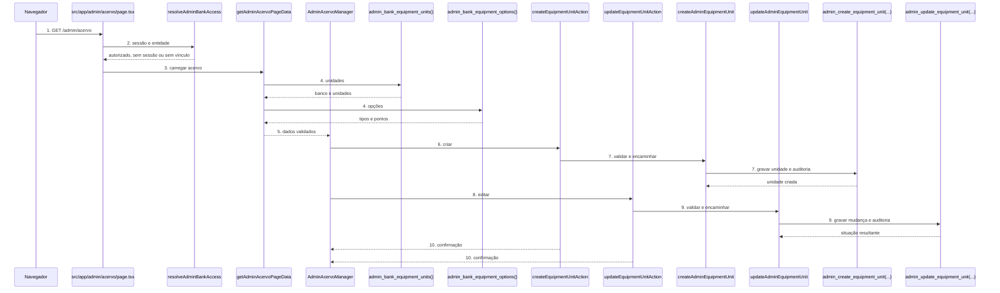
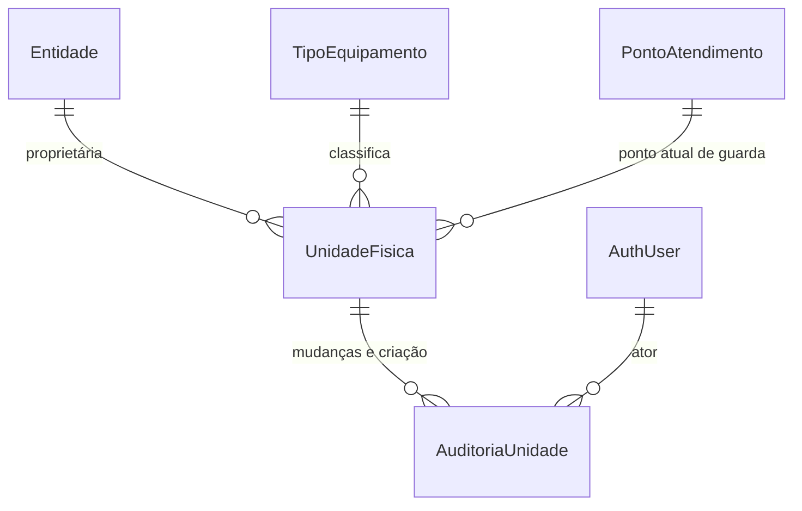
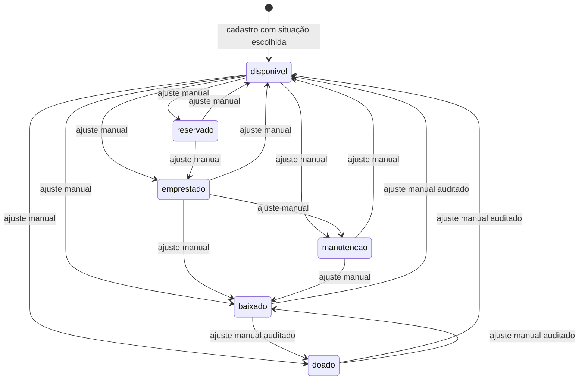

# Acervo e unidades físicas — FR-018 / FR-025 / FR-029

**Approved**: 2026-10-27 - user: "Plano aprovado. Sobre as pendências: não é necessário paginação por enquanto. E sobre a auditoria, também não há necessidade de definir agora, apenas será registrada e por enquanto os desenvolvedores acessam via banco diretamente"

## Problem

Hoje o `admin_banco` não tem nenhuma tela para consultar o próprio acervo nem para
corrigir o que a conferência física encontra. As unidades existem apenas em
`catalog.equipment_units`, sem identificador visível, sem origem de entrada e sem
ponto de guarda editável pela aplicação; qualquer correção exige acesso direto ao
banco. O painel público continua derivando a disponibilidade dessas mesmas
unidades, então um dado errado no acervo aparece para a comunidade como
disponibilidade errada.

As fontes não informam volume de unidades por banco nem frequência de correções.
O que existe é a regra de controle individual desde a Fase 1 e a exigência de que
cada peça tenha identidade interna e possa receber código visível depois.

Quando este recorte estiver disponível, o administrador do banco correto poderá
ver todas as unidades da sua entidade, entender a distribuição por situação,
cadastrar uma unidade com origem, identificador, ponto de guarda e situação
inicial, e corrigir identificador, ponto de guarda e situação de uma unidade
existente — sem enxergar nem alterar o acervo de outro banco.

## Shape

Reutiliza a sessão SSR e o resolvedor `resolveAdminBankAccess` já usados pela
área administrativa; a entidade proprietária nunca vem do navegador. As regras
que decidem o que o administrador vê e altera rodam no banco, em funções
`SECURITY DEFINER` com RLS forçada, provadas por `supabase test db`; a camada
Next.js só valida a forma da resposta e encaminha os formulários.

1. `GET /admin/acervo` -> página `src/app/admin/acervo/page.tsx` (new) - suspende a renderização, chama o carregador e mostra carregando, falta de acesso, falha, vazio ou sucesso.
2. `src/app/admin/acervo/page.tsx` (new) -> `getAdminBankAccess` via `resolveAdminBankAccess` (exists) - deriva `auth.uid()` e a entidade ativa; sem sessão redireciona para `/admin/entrar`, sem vínculo mostra falta de permissão.
3. `getAdminAcervoPageData` (new) -> RPC `admin_bank_equipment_units()` (door 4) - devolve o nome público do banco e as unidades da entidade derivada da sessão.
4. `getAdminAcervoPageData` (new) -> RPC `admin_bank_equipment_options()` (door 4) - devolve os tipos ativos e todos os pontos de atendimento para os formulários.
5. `getAdminAcervoPageData` (new) -> `AdminAcervoManager` (new) - recebe banco, unidades, tipos e pontos já validados; calcula o painel de contagens a partir das unidades recebidas.
6. `AdminAcervoManager` (new) -> server action `createEquipmentUnitAction` (new) - envia tipo, identificador, ponto de guarda, situação inicial e origem; a entidade é descartada do formulário.
7. `createAdminEquipmentUnit` (new) -> RPC `admin_create_equipment_unit(...)` (door 4) - valida tipo ativo, ponto existente, situação, origem, identificador livre e grava unidade mais auditoria na mesma transação.
8. `AdminAcervoManager` (new) -> server action `updateEquipmentUnitAction` (new) - envia unidade, identificador, ponto de guarda e situação; tipo e proprietário não são campos do formulário.
9. `updateAdminEquipmentUnit` (new) -> RPC `admin_update_equipment_unit(...)` (door 4) - trava a linha da entidade, ignora valores iguais, grava a mudança e a auditoria na mesma transação.
10. out: a página é revalidada e `AdminAcervoManager` (new) mostra o novo painel, a lista e a confirmação com um único próximo passo.

**Changes underneath**

| Front | What changes |
| --- | --- |
| domain | `catalog.equipment_units` passa a guardar `visible_code` e `entry_origin`, e a situação deixa de ser somente leitura administrativa; os leitores públicos de disponibilidade continuam usando apenas `situacao` e `owner_entity_id`. |
| stored data | Nada a migrar: `visible_code` e `entry_origin` entram nulos para as unidades existentes; a criação nova exige origem. Não há backfill nem reescrita de situação existente. |
| readers | A nova tela `/admin/acervo` lê unidades, tipos e pontos; `public.equipment_availability` e o detalhe público continuam lendo somente `situacao = 'disponivel'` e não recebem identificador, origem ou ponto de guarda. |

New: `visible_code` e `entry_origin` em `catalog.equipment_units`, o enum
`catalog.equipment_entry_origin` e a tabela
`catalog.equipment_unit_change_audit`. One-way constraints: `visible_code`
único por `owner_entity_id` quando não nulo (door 1); `entry_origin` fora do
conjunto é rejeitado por check e pela RPC (door 2); a auditoria referencia a
unidade e o ator e é append-only (door 3).

Qualquer um dos seis valores pode ir para qualquer outro nesta tela; a mudança
para o mesmo valor não cria transição nem auditoria. A decisão que amplia as
transições normais está em `AD-001`.

## Surface

| Route | In | Out | Status | Who |
| --- | --- | --- | --- | --- |
| `GET /admin/acervo` | sessão SSR, nenhum parâmetro | banco, unidades, tipos, pontos e painel de contagens | `200`; `307` para `/admin/entrar` sem sessão; `200` com falta de permissão sem revelar dados | `admin_banco` ativo com vínculo de entidade; qualquer outra pessoa recebe redirecionamento ou falta de permissão |
| `POST /rest/v1/rpc/admin_bank_equipment_units` | nenhum argumento | nome público do banco e unidades da entidade | `200`; `401` sem sessão; `403` sem vínculo ativo | `authenticated`; a entidade vem da sessão |
| `POST /rest/v1/rpc/admin_bank_equipment_options` | nenhum argumento | tipos ativos e pontos de atendimento | `200`; `401` sem sessão; `403` sem vínculo ativo | `authenticated`; a entidade vem da sessão |
| `POST /rest/v1/rpc/admin_create_equipment_unit` | `p_equipment_type_code`, `p_visible_code`, `p_storage_location_id`, `p_situation`, `p_entry_origin` | identificador interno da unidade criada | `200`; `400` para dado inválido ou identificador repetido; `401` sem sessão; `403` sem vínculo ativo | `authenticated`; proprietário derivado da sessão |
| `POST /rest/v1/rpc/admin_update_equipment_unit` | `p_unit_id`, `p_visible_code`, `p_storage_location_id`, `p_situation` | situação resultante | `200`; `400` para unidade de outro banco, dado inválido ou identificador repetido; `401` sem sessão; `403` sem vínculo ativo | `authenticated`; unidade e proprietário conferidos no banco |

## Landing

| One-way door | Literal shape | Alternative rejected |
| --- | --- | --- |
| Identificador visível por unidade | `catalog.equipment_units.visible_code text`, nulo permitido, `check (visible_code is null or (visible_code = btrim(visible_code) and char_length(visible_code) between 1 and 64))`, e `create unique index equipment_units_owner_visible_code_key on catalog.equipment_units (owner_entity_id, visible_code) where visible_code is not null` | Guardar o tombo só em texto livre sem índice único permitiria que o QR futuro apontasse para duas unidades; guardar em tabela separada duplicaria a identidade da unidade. |
| Origem de entrada | `create type catalog.equipment_entry_origin as enum ('doacao', 'compra', 'retorno_conserto', 'devolucao_outro_banco')` e `catalog.equipment_units.entry_origin catalog.equipment_entry_origin` nulo para registros anteriores | `text` sem enum aceitaria valores fora de FR-018; `not null` exigiria inventar a origem das unidades já existentes. |
| Auditoria de acervo | `catalog.equipment_unit_change_audit` com `actor_user_id`, `entity_id`, `unit_id`, `action` (`unit_created`, `unit_updated`), situação anterior/nova, ponto anterior/novo, identificador anterior/novo, origem e `created_at`; RLS forçada e insert somente pela RPC | Atualizar a unidade sem trilha contraria FR-031 e as Regras de Negócio; auditar em log de aplicação perderia ator e antes/depois de forma consultável. |
| Caminho de escrita privado | Role `admin_equipment_manager` `nologin noinherit nobypassrls`, herdando `admin_bank_authorization_checker`; RPCs `public.admin_bank_equipment_units()`, `public.admin_bank_equipment_options()`, `public.admin_create_equipment_unit(...)` e `public.admin_update_equipment_unit(...)` com `search_path = ''`, `row_security = on`, `owner` da role restrita e execute somente para `authenticated` | Conceder escrita direta em `catalog.equipment_units` às roles da Data API, ou receber `entity_id` do navegador, permitiria leitura e alteração entre entidades. |

- Nada mais neste recorte é difícil de reverter; a navegação, o painel e os formulários são reversíveis.

## Criteria

### S1: Consultar o acervo do próprio banco (P1)

O administrador autorizado abre `/admin/acervo` e vê o painel de situação e todas
as unidades da sua entidade, sem dados de outro banco.

**Acceptance Criteria**

1. WHEN um `admin_banco` ativo com vínculo à entidade E abre `/admin/acervo` THEN o sistema SHALL mostrar o nome público de E, as unidades cujo `owner_entity_id` é E e o painel com as contagens das seis situações.
2. WHEN o painel é exibido THEN o sistema SHALL mostrar as seis situações sempre, inclusive com quantidade `0`, usando os rótulos `Disponível no depósito`, `Aguardando retirada`, `Emprestado`, `Em manutenção`, `Doado` e `Retirado do acervo`.
3. WHEN a coleção de unidades é exibida THEN o sistema SHALL agrupá-la por tipo de equipamento, mostrar identificador, ponto de guarda e situação de cada unidade, e ordenar dentro do tipo por identificador crescente com identificadores nulos por último.
4. IF a entidade não tiver nenhuma unidade THEN o sistema SHALL mostrar o estado vazio com explicação e exatamente um próximo passo para cadastrar a primeira unidade.
5. IF a leitura falhar THEN o sistema SHALL mostrar mensagem compreensível e uma ação para tentar novamente, sem erro bruto do banco.
6. IF a sessão não tiver vínculo `admin_banco` ativo THEN o sistema SHALL mostrar falta de permissão sem revelar nome de banco, unidade ou contagem; sem sessão SHALL redirecionar para `/admin/entrar`.
7. WHEN a navegação da área administrativa é exibida THEN o sistema SHALL oferecer o link `Acervo de equipamentos` para `/admin/acervo`, sem menu escondido.

### S2: Cadastrar uma unidade física (P1)

O administrador registra a entrada de uma peça individual com origem, tipo,
identificador opcional, ponto de guarda opcional e situação inicial.

**Acceptance Criteria**

8. WHEN o administrador envia o cadastro com tipo ativo, situação entre as seis, origem entre `doacao`, `compra`, `retorno_conserto` e `devolucao_outro_banco`, identificador nulo ou livre e ponto de guarda nulo ou existente THEN o sistema SHALL gravar exatamente uma unidade com `owner_entity_id` igual à entidade da sessão.
9. WHEN o cadastro é concluído THEN o sistema SHALL mostrar confirmação com o tipo, a situação inicial e exatamente um próximo passo, e o painel SHALL refletir a nova contagem.
10. IF o identificador vier em branco ou somente com espaços THEN o sistema SHALL gravá-lo como nulo; se vier preenchido THEN SHALL removê-lo das extremidades e aceitar no máximo 64 caracteres.
11. IF o identificador já existir na mesma entidade THEN o sistema SHALL rejeitar o cadastro com mensagem que não exponha dados de outra unidade; o mesmo identificador em outra entidade SHALL ser aceito.
12. IF o tipo não existir ou estiver inativo, o ponto de guarda não existir, a situação não for uma das seis ou a origem não for uma das quatro THEN o sistema SHALL rejeitar o cadastro sem gravar unidade nem auditoria.
13. WHEN uma unidade é criada THEN o sistema SHALL gravar na mesma transação uma auditoria `unit_created` com ator, entidade, unidade, situação, ponto de guarda, identificador, origem e data/hora.

### S3: Editar uma unidade existente (P1)

O administrador corrige identificador, ponto de guarda e situação de uma unidade
do próprio banco, inclusive a partir de `doado` ou `baixado`, com auditoria.

**Acceptance Criteria**

14. WHEN o administrador envia a edição de uma unidade da entidade da sessão THEN o sistema SHALL alterar somente `visible_code`, `storage_location_id` e `situacao`, mantendo `equipment_type_code` e `owner_entity_id` iguais.
15. WHEN a situação é alterada para qualquer um dos seis valores THEN o sistema SHALL gravar o novo valor, inclusive `disponivel` a partir de `doado` ou `baixado`, e SHALL registrar uma auditoria `unit_updated` com situação anterior, situação nova, ponto anterior, ponto novo, identificador anterior, identificador novo, ator, entidade, unidade e data/hora.
16. WHEN a edição repete os valores já gravados THEN o sistema SHALL manter a unidade e não criar auditoria adicional; um reenvio após sucesso SHALL produzir o mesmo resultado.
17. IF a unidade pertencer a outra entidade ou não existir THEN o sistema SHALL responder com a mesma negação genérica, sem revelar se a unidade existe; nenhuma linha e nenhuma auditoria SHALL ser gravada.
18. IF dois pedidos simultâneos alterarem a mesma unidade THEN o sistema SHALL serializar as alterações pelo travamento da linha e cada alteração efetiva SHALL ter exatamente uma auditoria.
19. WHEN a edição é concluída THEN o sistema SHALL mostrar a situação resultante e exatamente um próximo passo, e o painel SHALL refletir a contagem atualizada.

### S4: Isolamento, estados e acessibilidade (P1)

O acervo é privado por entidade e a tela funciona para o público idoso em 360 px.

**Acceptance Criteria**

20. WHILE `anon`, uma sessão sem `admin_banco` ativo, uma sessão de outra entidade ou uma sessão com papel forjado pelo navegador tenta ler ou gravar THEN o sistema SHALL negar a operação no banco, e nenhuma role da Data API SHALL ler ou escrever `catalog.equipment_units` ou a auditoria diretamente.
21. WHEN uma criação ou edição aguarda resposta THEN o sistema SHALL mostrar indicador e texto de carregamento e SHALL impedir o envio duplicado.
22. WHEN o cadastro ou a edição falha por validação, conflito, rede ou servidor THEN o sistema SHALL mostrar mensagem compreensível e ação recuperável, sem erro bruto, SQL ou identificador interno.
23. WHEN a tela é revisada a 360 px THEN o sistema SHALL não ter rolagem horizontal; botões principais SHALL ter pelo menos 56 px de altura e texto em negrito de pelo menos 20 px; texto corrido SHALL ter pelo menos 18 px e títulos pelo menos 26 px; informação e foco SHALL não depender só de cor ou ícone; SHALL haver uma ação principal por tela; a paleta SHALL ser `#17458F`, `#F7A81B`, `#54565A`, `#1E7B3C` e `#B3261E`; a linguagem SHALL usar termos cotidianos como `acervo`, `situação`, `ponto de guarda` e `salvar`.
24. WHEN o administrador abre o formulário de cadastro THEN o sistema SHALL oferecer somente tipos ativos, todos os pontos de atendimento cadastrados, as seis situações com `Disponível no depósito` pré-selecionada e as quatro origens com rótulos em português; o ponto de guarda e o identificador SHALL poder ficar vazios.
25. WHEN uma unidade existente de um tipo hoje inativo é exibida THEN o sistema SHALL mostrar o nome do tipo e permitir editar identificador, ponto de guarda e situação, sem oferecer troca de tipo.

## Out of scope

| Excluded | Why |
| --- | --- |
| Excluir unidades, transferir propriedade ou cadastrar tipos e pontos | Não fazem parte do recorte; exclusão destruiria histórico e as demais operações pertencem à administração geral. |
| Empréstimo, devolução, doação e movimentação operacional | FR-019 a FR-023 e FR-028 têm fluxos próprios; esta tela só ajusta o cadastro da unidade e sua situação. |
| Estoque mínimo configurado, destaque de estoque baixo e indisponibilidade total | `AD-004`: não existe tabela de mínimo e o usuário limitou o painel às contagens por situação. |
| Filtros, busca, paginação e exportação da lista | O usuário escolheu lista agrupada por tipo sem filtros; `Unresolved 1` registra o limite de volume. |
| Leitura ou escrita de `admin_geral` | Nenhuma fonte deste recorte define o acesso global; o papel continua sem permissão nesta tela. |
| Exibir identificador, origem ou ponto de guarda no catálogo público | AC-002 limita a resposta pública a nome do banco e quantidade disponível. |
| Sincronizar ou gerar QR Code | O identificador prepara a vinculação futura, mas leitura e impressão de QR ficam para o inventário da Fase 2. |
| Editar `entry_origin` depois do cadastro e editar o tipo da unidade | A origem registra o evento de entrada e o tipo define a classificação; ambos permanecem como gravados. |
| Usar dados reais em migrations, seeds, testes ou evidências | `AGENTS.md` e os Critérios de Aceite exigem dados sintéticos. |

## Assumptions

| Assumption | Chosen default | Rationale | Confirmed? |
| --- | --- | --- | --- |
| Unidades antigas não têm origem conhecida | `entry_origin` fica nulo nelas; a RPC de criação exige origem e a interface mostra a ausência sem inventar valor | Evita backfill fictício e preserva o dado existente | y |
| Cadastro cria uma unidade por envio | Um formulário, uma unidade | O controle é individual desde a Fase 1 e o fluxo fica mais simples para o público idoso | n |
| Sem exclusão de unidade | A unidade pode mudar de situação, mas não é apagada | Preserva histórico e auditoria; `baixado`/`doado` já representam a saída do acervo | n |
| Lista completa sem paginação nesta tarefa | A RPC devolve todas as unidades da entidade; a lista é agrupada por tipo | O usuário confirmou que não é necessário paginação por enquanto | y |
| Rótulo do ponto de guarda | A interface usa `Ponto de guarda`; o nome técnico `storage_location_id` não aparece | As Regras de Negócio proíbem exibir o campo técnico e pedem vocabulário cotidiano | n |
| Identificador aceita qualquer texto de 1 a 64 caracteres | Sem formato obrigatório; espaços nas extremidades são removidos | O usuário definiu texto livre e o formato `BVCR0001` é apenas sugestão | y |
| Origem obrigatória no cadastro | Um dos quatro valores de FR-018 | O usuário confirmou origem obrigatória | y |
| Qualquer situação para qualquer situação | Seis valores de origem e destino; mesmo valor não audita | O usuário confirmou que a tela de inventário ignora as transições normais | y |
| Tipo imutável após o cadastro | O formulário de edição não oferece tipo | Evita reclassificar uma peça e distorcer contagens históricas | y |
| Pontos de guarda disponíveis | Todos os pontos cadastrados, porque não há vínculo entidade-ponto no esquema atual | O usuário confirmou todos os pontos e o vínculo fica para outra tarefa | y |
| Navegação | Link `Acervo de equipamentos` na navegação administrativa | O usuário escolheu o rótulo | y |
| Painel | Seis situações sempre visíveis, inclusive zero | O usuário escolheu leitura previsível | y |

**Open questions:**

| # | Kind | Question | Until answered |
| --- | --- | --- | --- |
| 1 | resolved 2026-10-27 | Qual o volume máximo de unidades por entidade e quando a lista precisará de paginação ou busca? | O usuário confirmou que não é necessário paginação por enquanto; a lista completa permanece. |
| 2 | resolved 2026-10-27 | Quem poderá ler a auditoria de acervo e por quanto tempo? | O usuário confirmou que não há necessidade de definir isso agora: a auditoria será registrada e, por enquanto, os desenvolvedores acessam diretamente pelo banco. |

## Differences from the source

| Source shows | Product shows | Confirmed |
| --- | --- | --- |
| Regras de Negócio limitam o administrador do banco às transições normais e tratam `doado` e `baixado` como terminais | A tela de inventário permite qualquer uma das seis situações para qualquer outra, com auditoria | y - AD-001 |
| Regras de Negócio sugerem o formato `SIGLA_ENTIDADE + SIGLA_TIPO + SEQUENCIAL_DE_4_DIGITOS` | O identificador é texto livre de até 64 caracteres, nulo e editável | y - AD-002 |
| FR-018 exige origem da entrada | A origem é registrada no cadastro e não é editável depois; unidades antigas ficam sem origem | y - AD-003 |
| FR-025 prevê destaque de estoque abaixo do mínimo configurado | O painel mostra apenas as contagens por situação, sem mínimo | y - AD-004 |
| UX descreve a área administrativa atual com apenas `/admin/entrar` e `/admin/contatos` | A área passa a ter `/admin/acervo`, acessível pela navegação | y - AD-005 |

## Sources

- `docs/produto/requisitos.md` — FR-018, FR-025, FR-026, FR-029 e FR-031; origem da entrada, contagens derivadas, propriedade distinta de ponto de guarda e auditoria.
- `docs/produto/regras-de-negocio.md` — seções 1 a 4 e 10: unidades individuais, código visível nulo, situação técnica e rótulos, transições e quadro de propriedade/ponto de guarda.
- `docs/produto/criterios-de-aceite.md` — AC-010, AC-011, AC-016, AC-017, AC-021, AC-022, AC-024 a AC-027; dados sintéticos e isolamento entre bancos.
- `docs/ux/acessibilidade-e-fluxos.md` — seções 1, 2, 6 e 7; medidas, linguagem, navegação administrativa, estados remotos e quadro de estoque.
- `docs/arquitetura/modelo-conceitual.md` e `docs/arquitetura/modelo-conceitual-acervo.mmd` — unidade física, identidade interna, código visível nulo, propriedade e ponto de guarda, contagens derivadas.
- `docs/arquitetura/autenticacao-e-autorizacao.md` — papel ativo, entidade derivada da sessão e RLS.
- `AGENTS.md` — paleta Rotary, acessibilidade a 360 px, linguagem cotidiana, RLS nas quatro entidades, dados sintéticos e automação limitada a `npm run build` e `supabase test db`.
- `src/lib/auth/admin-bank.ts`, `src/lib/contacts/admin-server.ts`, `src/app/admin/contatos/page.tsx` e `src/app/admin/contatos/actions.ts` — padrões existentes de sessão, validação de resposta, estados de tela e server actions.
- `supabase/migrations/20261013000000_disponibilidade_publica.sql`, `20261015000000_autenticacao_administrativa.sql` e `20261022000000_contatos_administrativos.sql` — tabelas de acervo, resolvedor de entidade, roles restritas, RPCs e auditoria.
- `supabase/seed.sql` e `supabase/tests/*.test.sql` — fixtures sintéticas, entidades, pontos, unidades e padrões de prova SQL.
- Decisões do usuário em 2026-10-27 — origem obrigatória, qualquer situação, identificador único por banco, tipo fixo, todos os pontos, lista agrupada sem filtros, rótulo `Acervo de equipamentos`, seis situações sempre visíveis e estoque mínimo fora do recorte.
