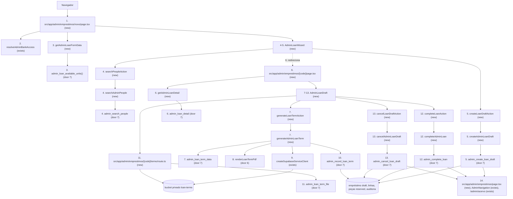
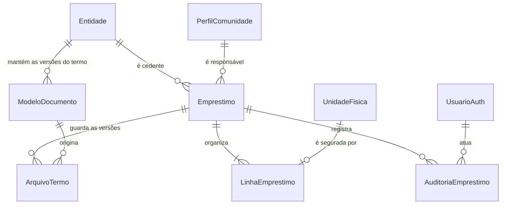
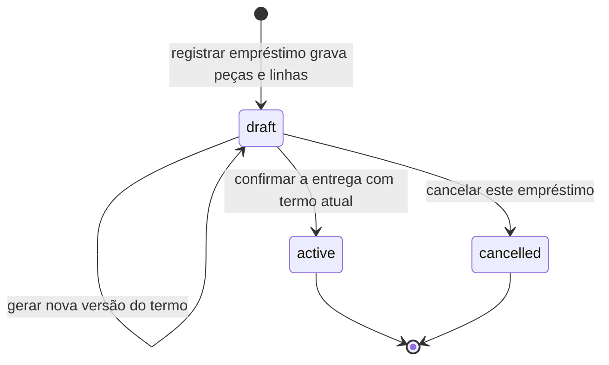
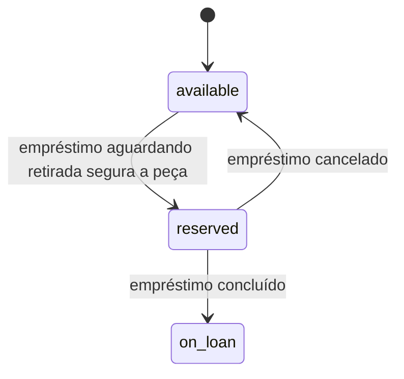

# Empréstimo de equipamentos — FR-019 / FR-020 / FR-021 / FR-031 / FR-034 / FR-042

**Approved**: 2026-10-28 - user: "Plano aprovado"

## Problem

Hoje o `bank_admin` não consegue registrar a saída de um equipamento. `/admin/acervo`
ajusta a situação de uma peça à mão (`AD-001`), então quem entrega uma cadeira de rodas
não tem onde registrar para quem ela foi, até quando, com qual termo e quais peças
saíram. A única forma de deixar o catálogo correto é mudar a peça para `on_loan` sem
qualquer registro de responsável, data ou documento, e o acervo passa a mostrar uma peça
"em posse de um responsável" que ninguém consegue identificar.

`FR-019`, `FR-020`, `FR-021`, `FR-034`, `FR-042` e `FR-031` existem no papel desde a
definição do MVP, mas nenhum deles tem tabela, função, rota ou tela. `AC-010` promete que
dois administradores registram "entrada, empréstimo com termo e devolução" em até três
minutos; hoje o empréstimo nem começa. As fontes não informam volume de empréstimos por
banco nem quantas pessoas já têm conta.

Quando este recorte estiver disponível, o administrador do banco correto vai poder
localizar a pessoa pelo nome ou CPF, ver os dados mínimos dela, escolher as peças
disponíveis do próprio acervo, informar o paciente quando for outra pessoa, escolher
prazo sugerido, outra data ou revisão sem data, gerar o termo, conferir o PDF, concluir a
saída e desistir de um empréstimo pela metade — com as peças ficando presas desde a
escolha até a conclusão, e tudo registrado com ator, entidade e data.

## Shape

Reutiliza a sessão SSR e o resolvedor `resolveAdminBankAccess` já usados pela área
administrativa, o padrão de role restrita com funções `SECURITY DEFINER` e RLS forçada do
recorte do acervo, a navegação `AdminNavigation`, o layout `PublicLayout` e o formato de
código público de 12 caracteres hexadecimais já usado em `catalog.community_contacts`.

As regras que decidem o que o administrador vê e grava — busca de pessoa, máscara de CPF
e telefone, quais peças aparecem, prazo, isolamento entre entidades, concorrência sobre a
mesma peça, versão do modelo e conclusão da saída — rodam no banco, em funções
`SECURITY DEFINER` com RLS forçada e provadas por `supabase test db`. O Next.js valida a
forma de cada resposta, monta o PDF e encaminha os formulários; nenhuma regra de
autorização ou de escopo é decidida no navegador.

1. `GET /admin/emprestimos/novo` -> `src/app/admin/emprestimos/novo/page.tsx` (new) - suspende a renderização, escolhe entre carregando, falta de acesso, falha e formulário.
2. `src/app/admin/emprestimos/novo/page.tsx` (new) -> `resolveAdminBankAccess` (exists) - deriva `auth.uid()` e a entidade ativa; sem sessão redireciona para `/admin/entrar`, sem vínculo mostra falta de permissão.
3. `getAdminLoanFormData` (new) -> `admin_loan_available_units()` (door 7) - devolve as peças `available` da entidade da sessão, o nome público do banco e o prazo sugerido configurado.
4. `AdminLoanWizard` (new) -> `searchPeopleAction` (new) -> `searchAdminPeople` (new) -> `admin_search_people` (p_query) (door 7) - devolve até 10 pessoas com nome, CPF mascarado, telefone mascarado e a contagem de empréstimos em aberto **deste** banco.
5. `AdminLoanWizard` (new) -> `createLoanDraftAction` (new) -> `createAdminLoanDraft` (new) -> `admin_create_loan_draft` (...) (door 7) - trava as peças, grava empréstimo `draft` mais uma linha por peça, muda cada peça para `reserved` e grava a auditoria `loan_draft_created` na mesma transação; devolve o código.
6. out: redireciona para `GET /admin/emprestimos/[code]` -> `src/app/admin/emprestimos/[code]/page.tsx` (new) -> `getAdminLoanDetail` (new) -> `admin_loan_detail` (p_public_code) (door 7) - devolve o empréstimo aguardando retirada do banco com pessoa, peças, datas e situação do termo.
7. `AdminLoanDraft` (new) -> `generateLoanTermAction` (new) -> `generateAdminLoanTerm` (new) -> `admin_loan_term_data` (p_public_code) (door 7) - devolve o modelo ativo da entidade (versão, texto, situação de revisão) e os dados do termo.
8. `generateAdminLoanTerm` (new) -> `renderLoanTermPdf` (door 6) - gera os bytes `application/pdf` a partir do modelo e dos dados, sem serviço externo.
9. `generateAdminLoanTerm` (new) -> `createSupabaseServiceClient` (exists) - envia o PDF ao bucket privado `loan-terms`, no caminho derivado no servidor, e devolve o hash do conteúdo.
10. `generateAdminLoanTerm` (new) -> `admin_record_loan_term` (...) (door 7) - grava o arquivo como atual, mantém as versões anteriores e audita `loan_term_generated` com versão e hash.
11. `AdminLoanDraft` (new) -> `GET /admin/emprestimos/[code]/termo` -> `src/app/admin/emprestimos/[code]/termo/route.ts` (new) -> `admin_loan_term_file` (p_public_code) (door 7) mais `createSupabaseServiceClient` (exists) - confere a sessão, baixa do bucket e entrega o PDF por link de sessão, sem token em URL.
12. `AdminLoanDraft` (new) -> `completeLoanAction` (new) -> `completeAdminLoan` (new) -> `admin_complete_loan` (p_public_code) (door 7) - exige o termo atual, muda o empréstimo para `ativo`, cada peça segurada para `on_loan` e grava `loan_completed` mais uma auditoria `unit_updated` por peça.
13. `AdminLoanDraft` (new) -> `cancelLoanDraftAction` (new) -> `cancelAdminLoanDraft` (new) -> `admin_cancel_loan_draft` (p_public_code) (door 7) - muda o empréstimo para `cancelado`, libera as linhas, devolve as peças para `available` e audita `loan_draft_cancelled`.
14. out: `GET /admin/emprestimos` -> `src/app/admin/emprestimos/page.tsx` (new) lista os empréstimos aguardando retirada do banco; `AdminNavigation` (exists) ganha o link `Empréstimos` e `/admin/acervo` (exists) passa a mostrar as peças seguradas como `Aguardando retirada`.

**Changes underneath**

| Front | What changes |
| --- | --- |
| domain | A situação de uma peça deixa de mudar só por ajuste manual: o fluxo de empréstimo passa a levar a peça de `available` para `reserved` enquanto aguarda retirada e de `reserved` para `on_loan` na conclusão, dentro das transições normais de `regras-de-negocio.md` §4. `AD-001` continua valendo em `/admin/acervo`, inclusive para trazer uma peça emprestada de volta a `available`; por isso a trava de saída não depende da situação e sim de a peça estar em um empréstimo não encerrado. |
| domain | `catalog.entities` ganha prazo sugerido em dias (90 provisório em todas as entidades), que substitui a pendência "confirmar o prazo sugerido inicial de cada banco" como configuração do banco. |
| stored data | Nada a migrar de empréstimo: as tabelas são novas. `loan_suggested_days` entra com `default 90` nas quatro entidades existentes, sem reescrita de outra coluna. Uma versão 1 do modelo de termo sintético é inserida para cada entidade já cadastrada, marcada como pendente de revisão jurídica. |
| readers | `/admin/acervo` passa a mostrar as peças aguardando retirada como `Aguardando retirada`, sem mudança de código. `public.equipment_availability` deixa de contar as peças aguardando retirada, porque `reserved` não conta como disponível. |

New: `catalog.document_models`, `catalog.loans`, `catalog.loan_lines`,
`catalog.loan_documents`, `catalog.loan_event_audit`, os enums
`catalog.document_type` e `catalog.loan_status`, a coluna
`catalog.entities.loan_suggested_days` e o bucket privado `loan-terms`.
One-way constraints: `catalog.loan_lines (unit_id)` único parcial onde
`released_at is null` (door 3); `(entity_id, document_type, version)` único e um único
modelo ativo por entidade e tipo (door 2); `catalog.loan_documents.storage_path` único e
um único arquivo atual por empréstimo, `(loan_id, version)` único (door 4).

## Surface

| Route | In | Out | Status | Who |
| --- | --- | --- | --- | --- |
| `GET /admin/emprestimos` | sessão SSR, nenhum parâmetro | nome público do banco e empréstimos aguardando retirada com código, nome da pessoa, quantidade de equipamentos e data | `200`; `307` para `/admin/entrar` sem sessão; `200` com falta de permissão sem revelar dados para quem não é `bank_admin` ativo | `bank_admin` ativo; as demais pessoas recebem `307` ou falta de permissão |
| `GET /admin/emprestimos/novo` | sessão SSR, nenhum parâmetro | banco, peças `available`, prazo sugerido em dias | `200`; `307` para `/admin/entrar` sem sessão; `200` com falta de permissão sem revelar dados | `bank_admin` ativo |
| `GET /admin/emprestimos/[code]` | código de 12 caracteres hexadecimais no caminho | empréstimo aguardando retirada ou empréstimo ativo do banco com pessoa mascarada, peças, datas e situação do termo | `200`; `307` sem sessão; `200` com recusa genérica para código de outro banco, código inexistente ou sessão sem vínculo | `bank_admin` ativo da entidade que fez a operação |
| `GET /admin/emprestimos/[code]/termo` | código no caminho | PDF do termo atual, `application/pdf` e `Content-Disposition: attachment; filename="termo-<code>.pdf"` | `200`; `307` sem sessão; `404` para termo de outro banco, código inexistente ou empréstimo sem termo gerado | `bank_admin` ativo da entidade que fez a operação |
| `POST /rest/v1/rpc/admin_search_people` | `p_query text` | linhas com identificador interno da conta, nome, CPF mascarado, telefone mascarado e contagem de empréstimos em aberto neste banco | `200`; `400` para texto com menos de 3 letras e diferente de 11 dígitos; `401` sem sessão; `403` sem `bank_admin` ativo | `authenticated`; a conta `anon` e a sessão sem vínculo recebem `401` e `403` |
| `POST /rest/v1/rpc/admin_loan_available_units` | nenhum argumento | peças `available` da entidade com tipo, número do equipamento e onde está guardado; nome público do banco; prazo sugerido | `200`; `401` sem sessão; `403` sem `bank_admin` ativo | `authenticated`; entidade derivada da sessão |
| `POST /rest/v1/rpc/admin_create_loan_draft` | `p_borrower_user_id uuid`, `p_unit_ids uuid[]`, `p_patient_name text`, `p_condition_note text`, `p_term_kind text`, `p_custom_days integer`, `p_review_days integer` | código do empréstimo, data de entrega, data de devolução ou data de revisão | `200`; `400` para prazo, paciente ou peças inválidas; `401` sem sessão; `403` sem vínculo ou para entidade inativa; `409` para peça que deixou de estar disponível | `authenticated`; responsável conferido contra `catalog.community_profiles` e entidade derivada da sessão |
| `POST /rest/v1/rpc/admin_loan_detail` | `p_public_code text` | empréstimo do banco com pessoa mascarada, paciente, peças, datas, anotação e situação do termo | `200`; `400` para código de outro banco ou inexistente, sempre com a mesma recusa; `401` sem sessão; `403` sem vínculo | `authenticated` da entidade que fez a operação |
| `POST /rest/v1/rpc/admin_loan_term_data` | `p_public_code text` | nome público do banco, nome completo e CPF do responsável, paciente, peças, datas, código e o modelo ativo com versão e situação de revisão | `200`; `400` para empréstimo que não está aguardando retirada deste banco; `401` sem sessão; `403` sem vínculo; `409` quando a entidade não tem modelo ativo | `authenticated` da entidade que fez a operação |
| `POST /rest/v1/rpc/admin_record_loan_term` | `p_public_code text`, `p_model_version integer`, `p_storage_path text`, `p_content_hash text` | versão do arquivo registrado | `200`; `400` para caminho fora do prefixo, hash inválido ou versão que não é a ativa; `401` sem sessão; `403` sem vínculo; `409` para empréstimo que não está aguardando retirada | `authenticated` da entidade que fez a operação |
| `POST /rest/v1/rpc/admin_loan_term_file` | `p_public_code text` | caminho privado do arquivo atual no bucket | `200`; `400` para empréstimo de outro banco, inexistente ou sem termo, sempre com a mesma recusa; `401` sem sessão; `403` sem vínculo | `authenticated` da entidade que fez a operação |
| `POST /rest/v1/rpc/admin_complete_loan` | `p_public_code text` | situação resultante do empréstimo e data de conclusão | `200`; `400` para empréstimo aguardando retirada sem termo atual; `401` sem sessão; `403` sem vínculo; `409` para empréstimo que não está aguardando retirada ou peça que saiu do estado segurado | `authenticated` da entidade que fez a operação |
| `POST /rest/v1/rpc/admin_cancel_loan_draft` | `p_public_code text` | situação resultante do empréstimo | `200`; `400` para empréstimo de outro banco ou inexistente; `401` sem sessão; `403` sem vínculo; `409` para empréstimo que não está aguardando retirada | `authenticated` da entidade que fez a operação |

## Landing

| One-way door | Literal shape | Alternative rejected |
| --- | --- | --- |
| Prazo sugerido por entidade | `alter table catalog.entities add column loan_suggested_days integer not null default 90 check (loan_suggested_days between 1 and 365);` | Tabela separada de configuração de prazo: duplicaria a chave da entidade para um único campo, e o modelo conceitual já trata prazo sugerido como atributo da entidade. Valor fixo no código: contraria `AC-037` e obrigaria deploy para cada banco mudar o prazo. |
| Modelo de termo versionado por entidade e tipo | `create type catalog.document_type as enum ('loan_term');` e `catalog.document_models (id uuid pk default gen_random_uuid(), entity_id uuid not null references catalog.entities (id) on delete restrict, document_type catalog.document_type not null, version integer not null check (version >= 1), body text not null check (char_length(btrim(body)) between 1 and 20000), review_status text not null check (review_status in ('pending_legal_review', 'approved')), is_active boolean not null default true, created_at timestamptz not null default clock_timestamp(), unique (entity_id, document_type, version))` mais `create unique index document_models_one_active_key on catalog.document_models (entity_id, document_type) where is_active` | Um único modelo no código: contraria `FR-034` e `AC-014`, que exigem o modelo da entidade. Texto editável em uma tabela sem versão: o empréstimo não conseguiria provar qual texto foi entregue à pessoa. |
| Empréstimo, linhas e a trava de uma peça por empréstimo aberto | `create type catalog.loan_status as enum ('draft', 'active', 'cancelled');` e `catalog.loans (id uuid pk default gen_random_uuid(), public_code text not null unique default upper(substr(replace(gen_random_uuid()::text, '-', ''), 1, 12)) check (public_code ~ '^[A-F0-9]{12}$'), entity_id uuid not null references catalog.entities (id) on delete restrict, borrower_user_id uuid not null references auth.users (id) on delete restrict, patient_name text, condition_note text, due_date date, review_date date, status catalog.loan_status not null default 'draft', created_by_user_id uuid not null references auth.users (id) on delete restrict, created_at timestamptz not null default clock_timestamp(), completed_at timestamptz, cancelled_at timestamptz)` com `constraint loans_patient_name_shape check (patient_name is null or char_length(btrim(patient_name)) between 2 and 120)`, `constraint loans_condition_note_shape check (condition_note is null or char_length(btrim(condition_note)) between 1 and 200)`, `constraint loans_term_shape check ((due_date is not null and review_date is null) or (due_date is null and review_date is not null))`; e `catalog.loan_lines (loan_id uuid not null references catalog.loans (id) on delete restrict, unit_id uuid not null references catalog.equipment_units (id) on delete restrict, released_at timestamptz, primary key (loan_id, unit_id))` mais `create unique index loan_lines_open_unit_key on catalog.loan_lines (unit_id) where released_at is null` | Travar a peça só pela `status` da unidade: `AD-001` permite que `/admin/acervo` devolva uma peça emprestada para `available`, e a mesma peça sairia duas vezes. Travar só na interface: duas abas abertas levariam a mesma peça. |
| Arquivo do termo e o bucket privado | `catalog.loan_documents (id uuid pk default gen_random_uuid(), loan_id uuid not null references catalog.loans (id) on delete restrict, document_model_id uuid not null references catalog.document_models (id) on delete restrict, version integer not null check (version >= 1), storage_path text not null unique check (storage_path ~ '^[0-9a-f-]{36}/[0-9a-f-]{36}/[0-9]{1,4}\.pdf$'), content_hash text not null check (content_hash ~ '^[0-9a-f]{64}$'), is_current boolean not null default true, created_by_user_id uuid not null references auth.users (id) on delete restrict, created_at timestamptz not null default clock_timestamp(), unique (loan_id, version))` mais `create unique index loan_documents_one_current_key on catalog.loan_documents (loan_id) where is_current`; bucket `loan-terms` privado, `file_size_limit` de 5 MiB, `allowed_mime_types` `{application/pdf}`, caminho `{entity_id}/{loan_id}/{version}.pdf` | Guardar o PDF fora do bucket, no sistema de arquivos do servidor: some no próximo deploy e não tem link autorizado. Link assinado exposto na página: o endereço com token vaza em histórico de navegador e em logs de proxy. |
| Auditoria de empréstimo | `catalog.loan_event_audit (id uuid pk default gen_random_uuid(), actor_user_id uuid not null references auth.users (id) on delete restrict, entity_id uuid not null references catalog.entities (id) on delete restrict, loan_id uuid not null references catalog.loans (id) on delete restrict, action text not null check (action in ('loan_draft_created', 'loan_term_generated', 'loan_completed', 'loan_draft_cancelled')), previous_status catalog.loan_status, new_status catalog.loan_status not null, unit_ids uuid[] not null default '{}', document_model_version integer, content_hash text, due_date date, review_date date, created_at timestamptz not null default clock_timestamp())`, RLS forçada, insert somente pelas RPCs | Auditar em log da aplicação: perde ator e antes/depois de forma consultável. Uma única linha por empréstimo concluído: um empréstimo aguardando retirada desistido e um termo reemitido não deixariam rastro, e `FR-021` não poderia ser provado. |
| Geração de PDF no servidor | `src/lib/emprestimos/term-pdf.ts` exportando `renderLoanTermPdf(input): Promise<Uint8Array>` com `Content-Type: application/pdf`, usando uma biblioteca pura de PDF declarada em `package.json` `dependencies` | Serviço externo de geração de PDF: enviaria nome e CPF do responsável para fora do perímetro, com custo por documento e dependência de rede. Impressão pelo navegador: o arquivo não existe no banco, e a prova do que foi entregue à pessoa se perde. |
| Caminho de escrita privado | Role `admin_loan_manager` `nologin noinherit nobypassrls`, herdando `admin_bank_authorization_checker`; grants de coluna em `catalog.community_profiles` (apenas `name`, `cpf`, `phone`), `catalog.loans`, `catalog.loan_lines`, `catalog.loan_documents`, `catalog.loan_event_audit`, `catalog.document_models` e `catalog.equipment_units`; RPCs `public.admin_*` com `search_path = ''`, `row_security = on`, `owner` da role restrita e execute somente para `authenticated`; RLS forçada com política de entidade igual a `public.current_admin_bank_entity_id()` | Conceder leitura de `catalog.community_profiles` às roles da Data API, ou receber `entity_id` do navegador: qualquer sessão listaria CPF e telefone de toda a comunidade e a operação atravessaria entidades. |

- Nada mais neste recorte é difícil de reverter: as rotas, os formulários, o assistente de passos e os textos são reversíveis.

## Criteria

### S1: Localizar a pessoa e segurar os equipamentos (P1)

O administrador do banco encontra a pessoa por nome ou CPF, escolhe as peças
disponíveis, define prazo e paciente e deixa o empréstimo aguardando retirada com as peças
seguradas.

**Acceptance Criteria**

1. WHEN um `bank_admin` ativo usa o campo `Buscar pessoa` com 3 ou mais caracteres THEN o sistema SHALL devolver no máximo 10 contas da comunidade cujo nome contenha o texto, sem diferenciar maiúsculas nem acentos, ordenadas por nome.
2. WHEN o texto digitado tem exatamente 11 dígitos THEN o sistema SHALL buscar pelo CPF exato, aceitando CPF com ou sem pontuação.
3. IF o texto tiver menos de 3 caracteres e não for um CPF de 11 dígitos THEN o sistema SHALL recusar com `400` e a mensagem `Digite pelo menos 3 letras do nome ou os 11 números do CPF.`, sem executar consulta.
4. WHEN a lista de resultados é exibida THEN o sistema SHALL mostrar, para cada pessoa, o nome completo, o CPF no formato `***.***.***-25` e o telefone no formato `(54) *****-1234`, guardando somente o DDD e os quatro últimos dígitos do telefone e os dois últimos dígitos do CPF.
5. WHEN existem homônimos THEN o sistema SHALL listar todos os resultados na mesma lista, cada um com sua escolha própria, sem escolher nenhum automaticamente.
6. WHEN mais de 10 pessoas correspondem à busca THEN o sistema SHALL mostrar os 10 primeiros em ordem de nome e a orientação `Refine a busca para ver outras pessoas.`
7. WHEN uma pessoa aparece no resultado THEN o sistema SHALL mostrar quantos empréstimos em aberto ela tem neste banco, e nunca exibir empréstimo, equipamento ou data de outra entidade.
8. IF nenhuma pessoa corresponder THEN o sistema SHALL mostrar `Não encontramos ninguém com esse nome ou CPF.` e exatamente um próximo passo para refazer a busca.
9. WHEN o administrador escolhe uma pessoa THEN o sistema SHALL mostrar `Pessoa escolhida` com o nome completo e o CPF mascarado e SHALL liberar o passo de equipamentos.
10. WHEN o passo de equipamentos é exibido THEN o sistema SHALL listar somente as peças do banco da sessão com `status = 'available'`, agrupadas por tipo e ordenadas por número do equipamento crescente, com seleção múltipla e sem filtro por tipo.
11. IF o banco da sessão não tiver nenhuma peça `available` THEN o sistema SHALL mostrar o estado vazio com explicação e exatamente um próximo passo para abrir `/admin/acervo`.
12. WHEN o administrador envia o empréstimo aguardando retirada com 1 a 50 peças de um ou mais tipos THEN o sistema SHALL gravar exatamente um empréstimo, uma linha de empréstimo por peça e SHALL usar como entidade a entidade da sessão, ignorando qualquer entidade enviada pelo navegador.
13. WHEN o formulário de prazo é exibido THEN o sistema SHALL oferecer as três opções `Prazo sugerido (90 dias)`, `Outra data` e `Sem data de devolução`, com `Prazo sugerido` pré-selecionado e a quantidade de dias vinda de `catalog.entities.loan_suggested_days` da entidade da sessão.
14. WHEN a opção `Outra data` é enviada com 30 dias THEN o sistema SHALL gravar `due_date` igual à data de hoje, no fuso `America/Sao_Paulo`, somada de 30 dias e SHALL gravar `review_date` nula.
15. IF a opção `Outra data` vier com 0 dias, com 366 dias ou sem número THEN o sistema SHALL recusar com `400` e a mensagem `Escolha um prazo entre 1 e 365 dias.`, sem gravar empréstimo, linha, peça ou auditoria.
16. WHEN a opção `Sem data de devolução` é enviada com a revisão sugerida THEN o sistema SHALL gravar `due_date` nula e `review_date` igual à data de hoje mais 90 dias, permitindo trocar por qualquer valor entre 1 e 365 dias.
17. IF a opção `Sem data de devolução` chegar sem uma revisão entre 1 e 365 dias THEN o sistema SHALL recusar com `400` e a mensagem `Informe em quanto tempo o banco vai revisar este empréstimo.`, sem gravar nada.
18. WHEN o administrador escolhe `Outra pessoa` e informa um nome com 2 a 120 caracteres THEN o sistema SHALL gravar o nome do paciente removendo espaços das extremidades; WHEN escolhe `A própria pessoa` THEN o sistema SHALL gravar `patient_name` nulo.
19. IF o nome do paciente for informado com menos de 2 ou mais de 120 caracteres THEN o sistema SHALL recusar com `400` e a mensagem `Informe o nome de quem vai usar o equipamento, com até 120 letras.`, sem gravar nada.
20. WHEN o administrador preenche a anotação `Como o equipamento está sendo entregue?` com até 200 caracteres THEN o sistema SHALL gravar a anotação sem espaços nas extremidades; IF a anotação exceder 200 caracteres THEN o sistema SHALL recusar com `400` e não gravar nada.
21. WHEN o empréstimo aguardando retirada é gravado THEN o sistema SHALL mudar cada peça escolhida para `reserved` e SHALL gravar na mesma transação uma auditoria `loan_draft_created` com ator, entidade, empréstimo, as peças, a data de devolução ou de revisão e a data/hora.
22. IF alguma peça escolhida não estiver em `available` ou já estiver em um empréstimo não encerrado THEN o sistema SHALL recusar a operação inteira com `409` e a mensagem `O equipamento <tipo> <identificador> não está mais disponível. Atualize a lista e escolha outro.`, sem gravar empréstimo, linha, peça ou auditoria, e sem repetir o nome da pessoa.
23. WHEN duas requisições simultâneas escolhem a mesma peça THEN o sistema SHALL deixar exatamente uma concluir com `200` e responder `409` à outra, e a peça SHALL ficar em um único empréstimo aberto.
24. WHEN o mesmo empréstimo é reenviado com a mesma pessoa, as mesmas peças e as mesmas datas THEN o sistema SHALL responder `200` com o mesmo código e SHALL NOT criar segundo empréstimo nem segunda auditoria.
25. IF a entidade da sessão estiver inativa THEN o sistema SHALL recusar o empréstimo com `403` e a mensagem `Este banco não está recebendo novos empréstimos.`, sem gravar nada.
26. WHEN a pessoa escolhida não tiver nenhuma conta da comunidade THEN o sistema SHALL mostrar o estado vazio de busca e um único próximo passo, sem criar conta nem empréstimo neste recorte.
27. WHEN a entrega é confirmada THEN o sistema SHALL redirecionar para `/admin/emprestimos/<code>` e essa página SHALL mostrar o código, a pessoa, as peças seguradas, a data de entrega e a data de devolução ou de revisão.
28. WHEN `/admin/emprestimos` é exibida THEN o sistema SHALL listar os empréstimos aguardando retirada do banco da sessão com código, nome da pessoa, quantidade de equipamentos e data de criação, do mais recente para o mais antigo, e SHALL oferecer exatamente uma ação principal para começar um novo empréstimo.

### S2: Termo gerado e entrega confirmada (P1)

O administrador gera o termo a partir do modelo da entidade, baixa o PDF, conclui a saída
e, se desistir, devolve as peças ao depósito.

**Acceptance Criteria**

29. WHEN um empréstimo aguardando retirada do banco da sessão é aberto THEN o sistema SHALL mostrar `Termo ainda não gerado` ou `Termo gerado em <data e hora> — versão <n>`, junto com a pessoa, as peças e as datas.
30. WHEN o administrador usa `Gerar termo` THEN o sistema SHALL usar o modelo ativo da entidade da sessão para o tipo de documento `loan_term` e SHALL registrar a versão usada no arquivo gerado.
31. IF a entidade não tiver modelo ativo para `loan_term` THEN o sistema SHALL recusar com `409` e a mensagem `Este banco ainda não tem um modelo de termo ativo.`, sem gravar arquivo nem auditoria.
32. WHEN o termo é gerado THEN o PDF SHALL conter o nome público do banco cedente, o nome completo e o CPF do responsável no formato `000.000.000-00`, o nome do paciente quando houver, cada equipamento com nome do tipo e número do equipamento (ou `Sem número`), a anotação de estado quando preenchida, a data de entrega, a data de devolução ou de revisão, o código do empréstimo e duas linhas `Assinatura do responsável` e `Assinatura do representante do banco`, e SHALL NOT conter telefone, endereço, diagnóstico ou dado de outra entidade.
33. WHEN o modelo usado está com `review_status = 'pending_legal_review'` THEN o termo SHALL trazer no rodapé `Modelo provisório — versão <n> — pendente de revisão jurídica`.
34. WHEN o termo é gerado THEN o sistema SHALL gravar o arquivo no bucket privado `loan-terms` no caminho `<entity_id>/<loan_id>/<version>.pdf`, sem nome, CPF ou telefone no caminho, e SHALL gravar a auditoria `loan_term_generated` com ator, entidade, empréstimo, versão do modelo e hash do conteúdo.
35. WHEN o mesmo termo é gerado de novo sem nenhuma alteração nos dados THEN o sistema SHALL manter um único arquivo atual e SHALL NOT gravar segunda auditoria `loan_term_generated`.
36. WHEN o termo é gerado de novo depois de uma alteração permitida enquanto aguarda retirada THEN o sistema SHALL gravar a versão seguinte, manter a anterior e SHALL marcar como atual somente a mais recente.
37. WHEN o administrador usa `Baixar termo` THEN o sistema SHALL responder `200` com `application/pdf`, `Content-Disposition: attachment; filename="termo-<code>.pdf"` e o conteúdo do arquivo atual do empréstimo do banco da sessão.
38. IF quem pede o PDF for de outra entidade, não tiver sessão de `bank_admin` ativa, ou o empréstimo não tiver termo gerado THEN o sistema SHALL responder `404` com a mesma resposta, sem revelar se o empréstimo existe.
39. WHEN o administrador usa `Confirmar entrega` em um empréstimo aguardando retirada com termo atual THEN o sistema SHALL mudar o empréstimo para `ativo`, mudar cada peça segurada para `on_loan` e gravar, na mesma transação, a auditoria `loan_completed` e uma auditoria `unit_updated` por peça com situação anterior `reserved` e situação nova `on_loan`.
40. IF `Confirmar entrega` for usada em um empréstimo aguardando retirada sem termo atual THEN o sistema SHALL recusar com `400` e a mensagem `Gere o termo antes de confirmar a entrega.`, sem mudar empréstimo nem peça.
41. IF alguma peça segurada tiver saído de `reserved` por ajuste manual em `/admin/acervo` THEN `Confirmar entrega` SHALL recusar com `409` e a mensagem `A situação de um equipamento mudou. Confira o acervo antes de concluir.`, sem mudar empréstimo nem peça.
42. WHEN `Confirmar entrega` ou `Gerar termo` for usado em um empréstimo que não está aguardando retirada THEN o sistema SHALL recusar com `409`, sem gravar arquivo, peça ou auditoria.
43. WHEN a saída é concluída THEN o sistema SHALL mostrar a confirmação com o código, a data de devolução ou de revisão e exatamente um próximo passo para abrir `/admin/acervo`, e o termo SHALL continuar disponível para download.
44. WHEN o administrador usa `Cancelar este empréstimo` e confirma THEN o sistema SHALL mudar o empréstimo para `cancelado`, marcar `released_at` em todas as linhas, devolver cada peça para `available` e gravar a auditoria `loan_draft_cancelled`, sem gerar termo.
45. IF `Cancelar este empréstimo` for usado em um empréstimo que não está aguardando retirada THEN o sistema SHALL recusar com `409` e não alterar peça nem situação.
46. WHEN um empréstimo é cancelado THEN o sistema SHALL permitir um novo empréstimo com a mesma pessoa e as mesmas peças.
47. IF o código do caminho pertencer a outro banco ou não existir THEN `/admin/emprestimos/<code>` SHALL mostrar a mesma recusa genérica `Empréstimo não encontrado neste banco.`, sem revelar existência e sem exibir nenhum nome.

### S3: Isolamento, leitores, estados e acessibilidade (P1)

O empréstimo é privado por entidade, aparece no acervo e funciona para o público idoso em
360 px.

**Acceptance Criteria**

48. WHILE `anon`, uma sessão sem `bank_admin` ativo, uma sessão de outra entidade ou uma sessão com papel forjado pelo navegador tentar ler ou gravar THEN o sistema SHALL negar a operação no banco, e nenhuma role da Data API SHALL ler ou escrever `catalog.loans`, `catalog.loan_lines`, `catalog.loan_documents`, `catalog.loan_event_audit`, `catalog.document_models` ou `catalog.community_profiles` diretamente.
49. WHEN um empréstimo aguardando retirada segura peças THEN `/admin/acervo` SHALL mostrar essas peças com o rótulo `Aguardando retirada`, sem mudança de código na tela de acervo.
50. WHEN um empréstimo aguardando retirada segura peças THEN a disponibilidade pública do tipo SHALL deixar de contar essas peças, porque `reserved` não conta como disponível.
51. WHEN qualquer resposta de busca, detalhe ou termo é produzida THEN o sistema SHALL NOT incluir CPF ou telefone completo, e CPF, telefone e nome SHALL NOT aparecer em URL, log ou mensagem de erro.
52. WHEN uma tela do fluxo aguarda resposta THEN o sistema SHALL mostrar indicador e texto de carregamento e SHALL impedir o envio duplicado; IF uma gravação falhar por validação, conflito, rede ou servidor THEN o sistema SHALL mostrar mensagem compreensível e ação recuperável, sem erro bruto, SQL ou identificador interno.
53. WHEN a tela é revisada a 360 px THEN o sistema SHALL não ter rolagem horizontal; botões principais SHALL ter pelo menos 56 px de altura e texto em negrito de pelo menos 20 px; texto corrido SHALL ter pelo menos 18 px e títulos pelo menos 26 px; informação e foco SHALL não depender só de cor ou ícone; SHALL haver uma ação principal por tela; a paleta SHALL ser `#17458F`, `#F7A81B`, `#54565A`, `#1E7B3C` e `#B3261E`; a linguagem SHALL usar termos cotidianos como `empréstimo`, `equipamento`, `situação`, `prazo`, `revisão` e `salvar`.
54. WHEN o formulário de empréstimo é exibido THEN o sistema SHALL dividi-lo em 4 passos curtos com `Passo 1 de 4` até `Passo 4 de 4`, controles nativos com rótulo associado, foco visível, mensagem de erro ligada ao campo e um `Voltar` em posição previsível.
55. WHEN a navegação da área administrativa é exibida THEN o sistema SHALL oferecer o link `Empréstimos` para `/admin/emprestimos`, anunciar a página atual e não depender de menu escondido.
56. WHEN um empréstimo aguardando retirada fica parado THEN o sistema SHALL mantê-lo na lista de `/admin/emprestimos` com as peças em `Aguardando retirada` até que o administrador conclua ou desista, sem expiração automática.

## Out of scope

| Excluded | Why |
| --- | --- |
| Devolução total ou parcial, estado na devolução e destino posterior (`FR-022`) | Próximo recorte; este só leva a peça a `on_loan` e não a devolve. `released_at` já deixa o campo pronto para a liberação na devolução. |
| Doação definitiva (`FR-023`) | Fluxo próprio, com termo de doação que não apresenta obrigação de devolução. |
| Lembretes, tentativas de contato e nova data de revisão (`FR-024`) | Dependem de lista de hoje e de mensagens prontas; aqui só se grava a data de devolução ou de revisão. |
| Foto do termo assinado em bucket privado | O usuário decidiu em 2026-10-28 que o anexo do termo assinado fica para um recorte próprio; este guarda apenas o PDF gerado pelo sistema. |
| Endereço residencial no empréstimo | O usuário decidiu em 2026-10-28 não coletar endereço nesta fase; o modelo sintético não o exige. `NFR-005` e a minimização continuam valendo. |
| Vínculo entre contato e empréstimo | O usuário decidiu em 2026-10-28 manter só a situação `converted_to_loan` já existente em `/admin/contatos`, como `regras-de-negocio.md` §6 determina. |
| Cadastro assistido para pessoa sem conta (`FR-041`) | Fluxo próprio com confirmação de telefone pela pessoa; aqui, quem não tem conta recebe o estado vazio da busca. |
| Administração de modelos, entidades e permissões (`FR-027`) | O modelo sintético é semeado pela migration e não tem tela de edição; a administração de modelos é do administrador geral. |
| Tela de consulta de auditoria | O usuário decidiu em 2026-10-28 que os eventos são registrados e lidos direto no banco, como no recorte do acervo. |
| Renovação, segundo termo depois da conclusão e alteração do empréstimo ativo | `regras-de-negocio.md` §5 deixa a renovação para quando houver histórico de datas; aqui o empréstimo ativo é imutável. |
| QR Code, assinatura desenhada na tela e envio automático de mensagens | Fora do MVP por `requisitos.md` §3. |
| Painel do Companheiro (`FR-043`) e mínimo de estoque (`FR-044`) | Recortes próprios; nenhuma tela deste fluxo é agregada. |
| Paginação, filtros e exportação da lista de empréstimos | O usuário confirmou em 2026-10-27 que lista completa sem paginação basta por enquanto, e o mesmo limite vale aqui. |
| Usar dados reais em migrations, seeds, testes ou evidências | `AGENTS.md` e os Critérios de Aceite exigem dados sintéticos. |

## Assumptions

| Assumption | Chosen default | Rationale | Confirmed? |
| --- | --- | --- | --- |
| Formato e armazenamento do termo | PDF gerado no servidor a partir de modelo versionado por entidade e tipo, guardado em bucket privado e baixado por link de sessão; texto sintético nesta fase | Decisão do usuário em 2026-10-28 | y |
| Momento da conclusão da saída | Duas etapas: o empréstimo aguardando retirada segura as peças em `reserved`; a conclusão só ocorre depois do termo gerado | Decisão do usuário em 2026-10-28, para atender `FR-021` sem risco de saída sem documento | y |
| Forma da busca de pessoa | Um campo: nome parcial com no mínimo 3 letras ou CPF completo com 11 dígitos; até 10 resultados; nomes, CPF e telefone mascarados; histórico apenas do banco da sessão | Decisão do usuário em 2026-10-28 | y |
| Paciente diferente do responsável | Somente o nome, de 2 a 120 caracteres, opcional, impresso no termo | Decisão do usuário em 2026-10-28 | y |
| Prazos | Configuração por entidade com 90 dias provisórios; customizado de 1 a 365 dias; sem data exige revisão sugerida em 90 dias e editável | Decisão do usuário em 2026-10-28 | y |
| Unidades do empréstimo | Várias peças e vários tipos; somente `available`; trava de linha mais índice único de peça em empréstimo aberto | Decisão do usuário em 2026-10-28 | y |
| Endereço | Não coletado nesta fase; sem campo na tela nem no termo | Decisão do usuário em 2026-10-28 | y |
| Foto do termo assinado | Fora deste recorte; só o PDF gerado é guardado | Decisão do usuário em 2026-10-28 | y |
| Contato que virou empréstimo | Nenhum vínculo novo; `converted_to_loan` continua sendo marcado em `/admin/contatos` | Decisão do usuário em 2026-10-28 | y |
| Auditoria | Quatro eventos gravados sem tela de consulta: `loan_draft_created`, `loan_term_generated`, `loan_completed`, `loan_draft_cancelled` | Decisão do usuário em 2026-10-28, com o cancelamento acrescentado pela pergunta seguinte | y |
| Conteúdo do termo sobre a pessoa | Nome completo e CPF formatado do responsável; paciente apenas pelo nome; telefone não impresso | Decisão do usuário em 2026-10-28 | y |
| Empréstimo abandonado | O administrador desiste do empréstimo aguardando retirada, as peças voltam a `available` e nada expira sozinho | Decisão do usuário em 2026-10-28; o projeto não tem agendador | y |
| Tamanho da entrega | Entrega única com três fatias internas, na ordem S1, S2, S3 | Decisão do usuário em 2026-10-28 | y |
| Código público do empréstimo | 12 caracteres hexadecimais maiúsculos, como o código de contato já existente, impresso no termo e usado no caminho das rotas | Dá um identificador sem dado pessoal para a tela, o termo e a futura devolução | n |
| Estado do equipamento no termo | Uma anotação opcional por empréstimo, de até 200 caracteres, repetida sob cada peça | Decidido em 2026-10-28 como uma anotação por empréstimo; uma condição por peça exigiria taxonomia que nenhuma fonte define | n |
| Reemissão do termo | Enquanto estiver aguardando retirada, gerar de novo cria a próxima versão; a anterior fica guardada e só a mais recente é atual | Evita perder o que já foi impresso e mantém uma única versão válida | n |
| Valor provisório do prazo sugerido | 90 dias em todas as entidades, até cada banco confirmar | `requisitos.md` §8 mantém a confirmação por banco como pendência de produto | n |
| Peça liberada por ajuste manual | `AD-001` continua valendo em `/admin/acervo`; a trava do empréstimo vem do índice único de linha aberta, e a conclusão recusa peça que saiu de `reserved` | Não muda a decisão do recorte anterior e ainda impede saída dupla | n |
| Link do termo | Rota autenticada que entrega o PDF da sessão, em vez de URL assinada exposta na página | A URL assinada com token vaza em histórico e log de proxy; o caminho do arquivo não sai do servidor | n |

**Open questions:** none - all resolved or logged above.

## Differences from the source

| Source shows | Product shows | Confirmed |
| --- | --- | --- |
| `regras-de-negocio.md` §9 exige que o termo identifique o "estado" dos equipamentos, sem definir onde esse dado nasce | O termo imprime uma anotação opcional por empréstimo, escrita pelo administrador, sob cada equipamento; não há condição por peça | y - AD-006 |
| `regras-de-negocio.md` §5 registra propostas de prazo por banco ainda não confirmadas (seis meses, 90 dias, data negociada, pendente) | Todas as entidades começam com 90 dias configuráveis, sem confirmar o valor de cada banco | y - AD-007 |
| `requisitos.md` §3 inclui "armazenamento opcional de foto do termo assinado" e `FR-036` exige bucket privado | Este recorte guarda apenas o PDF gerado pelo sistema; a foto do termo assinado fica para um recorte próprio | y - AD-008 |
| `FR-019` permite solicitar endereço nesta etapa se o modelo aprovado exigir | Nenhum campo de endereço é coletado nesta fase | y - AD-009 |
| `docs/ux/acessibilidade-e-fluxos.md` §3 e §6 descrevem a área administrativa com `/admin/entrar` e `/admin/contatos` apenas | A área passa a ter `/admin/emprestimos`, `/admin/emprestimos/novo` e `/admin/emprestimos/[code]`, com o link `Empréstimos` na navegação | y - AD-010 |
| Regras de Negócio não definem identificador para o empréstimo | O empréstimo recebe um código de 12 caracteres hexadecimais, impresso no termo e usado no caminho das rotas | y - AD-011 |

As decisões `AD-006` a `AD-011` serão registradas em `.specs/STATE.md` na aprovação
deste plano; esta sessão produz somente este arquivo.

## Sources

- `docs/produto/requisitos.md` — FR-019, FR-020, FR-021, FR-031, FR-034 e FR-042; §2 item 8 (endereço), §3 (foto do termo assinado), §8 (prazo sugerido pendente e revisão jurídica).
- `docs/produto/regras-de-negocio.md` — §4 (situações e transições), §5 (empréstimos, paciente, prazos, uma peça por empréstimo ativo), §6 (contato não gera empréstimo), §9 (documentos e conteúdo do termo), §11 (integridade e entidade inativa).
- `docs/produto/criterios-de-aceite.md` — AC-010, AC-014, AC-017, AC-019, AC-021, AC-022, AC-024 a AC-028 e AC-037.
- `docs/produto/mensagens-padrao.md` — limites de privacidade das mensagens; nenhuma mensagem é enviada por este recorte.
- `docs/ux/acessibilidade-e-fluxos.md` — §1 medidas e uma ação principal, §2 linguagem cotidiana, §6 fluxo do administrador e busca de pessoa, §7 estados de interface.
- `docs/ux/identidade-visual.md` — paleta Rotary, Open Sans, cantos de 8 px e ausência de degradês.
- `docs/arquitetura/autenticacao-e-autorizacao.md` — §3 papéis, §4 matriz (PII mínima no fluxo do próprio banco), §5 RLS e operações atômicas, §6 storage privado e link temporário.
- `docs/arquitetura/modelo-conceitual.md` — §3 unidade física e movimentação, §4 empréstimo e linha de empréstimo, §5 modelo e arquivo gerado, auditoria, §6 invariantes.
- `docs/privacidade/requisitos-de-dados.md` — §1 minimização e paciente somente pelo nome, §2 classificação, §5 retenção, §6 segurança.
- `AGENTS.md` — paleta, acessibilidade a 360 px, linguagem cotidiana, RLS nas quatro entidades, dados sintéticos e automação limitada a `npm run build` e `supabase test db`.
- `.specs/STATE.md` — `AD-001` (ajuste livre de situação em `/admin/acervo`) e `AD-004` (estoque mínimo fora do recorte).
- `.specs/features/acervo-unidades-fisicas-fr-018-fr-025-fr-029/plan.md` — padrão de roles restritas, funções `SECURITY DEFINER`, auditoria e estados de tela do recorte anterior.
- `src/lib/auth/admin-bank.ts`, `src/lib/acervo/admin-server.ts`, `src/lib/contacts/admin-server.ts`, `src/app/admin/acervo/page.tsx`, `src/app/admin/acervo/actions.ts`, `src/app/admin/_components/admin-navigation.tsx` — padrões existentes de sessão, validação de resposta, server actions, navegação e estados de tela.
- `supabase/migrations/20261013000000_public_availability.sql`, `20261014000000_community_authentication.sql`, `20261014010000_community_contacts.sql`, `20261014020000_private_profile_and_uid_rls.sql`, `20261022000000_admin_contacts.sql` e `20261028000000_equipment_inventory.sql` — tabelas de acervo, perfil da comunidade, roles restritas, RPCs, auditoria e o formato de código público.
- `supabase/seed.sql` e `supabase/tests/equipment-inventory.test.sql` — fixtures sintéticas e padrão de prova SQL com `pg_temp` e `set_config`.
- Decisões do usuário em 2026-10-28 — termo em PDF versionado por entidade em bucket privado, duas etapas, com o empréstimo aguardando retirada, busca por nome parcial ou CPF com até 10 resultados mascarados, paciente somente pelo nome até 120 caracteres, prazo por entidade com 90 dias provisórios, várias peças com trava no banco, sem endereço, sem foto do termo, sem vínculo com contato, quatro eventos de auditoria sem tela, termo com nome e CPF do responsável, empréstimo cancelado pelo administrador e entrega única em três fatias.
