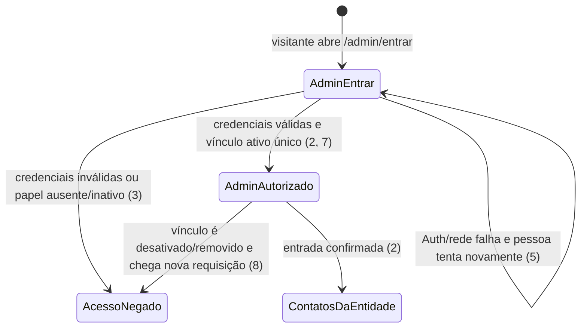
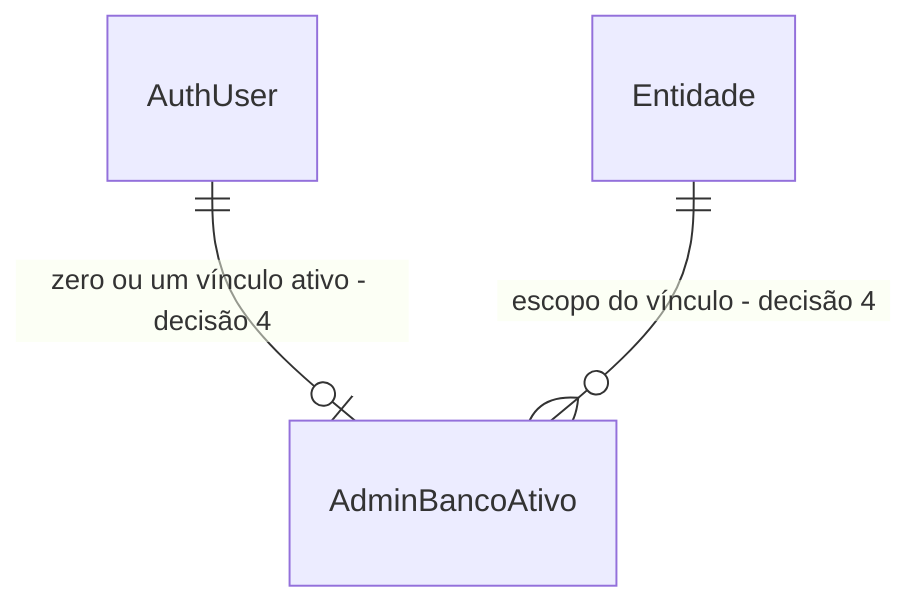

# Acesso e sessão administrativa — `admin_banco`

> Build this with **tlc-implement** (`.opencode/skills/tlc-implement/SKILL.md`).
> Every criterion below becomes a check with a proof, referenced by its number. Nothing under
> `Unresolved` gets settled while building.

## Intent

Hoje, `/entrar` atende à Comunidade e a aplicação não oferece uma entrada administrativa nem verifica `admin_banco`. Embora `catalog.user_roles` já comporte esse papel e um vínculo de entidade, nenhuma página ou operação do app estabelece ou valida uma sessão administrativa. Isso mantém bloqueada a tarefa de contatos recebidos FR-017/AC-007. As fontes não quantificam administradores afetados.

Quando este recorte estiver disponível, uma conta previamente criada no Supabase Auth poderá entrar em `/admin/entrar` com e-mail e senha. O acesso administrativo dependerá de um vínculo ativo `admin_banco` com exatamente uma entidade, revalidado no servidor e no banco a cada requisição protegida. A entrada administrativa permanecerá separada do fluxo da Comunidade; depois da entrada, a pessoa seguirá para `/admin/contatos`.

12 critérios em 2 fatias · 5 portas unidirecionais · 8 pendências: 3 bloqueiam go-live e 5 abertas.

## Criteria

### Entrar com uma conta administrativa previamente provisionada

1. Dado um visitante, quando abre `/admin/entrar`, então vê campos identificados `E-mail` e `Senha`, uma ação `Entrar` e nenhuma opção de criar cadastro administrativo. `/entrar` permanece exclusivo da Comunidade e não tem seu comportamento alterado.
2. Dada uma conta Auth com credenciais válidas e exatamente um vínculo ativo `admin_banco`, quando a pessoa entra, então a sessão é aceita e a aplicação a encaminha para `/admin/contatos`. A autorização da tela continua limitada à única entidade vinculada; o destino não é escolhido por `entity_id` enviado pelo navegador.
3. Se as credenciais forem inválidas ou a conta não tiver vínculo ativo `admin_banco`, então a entrada administrativa é negada com uma mensagem genérica que não distingue conta inexistente, senha inválida ou papel ausente/inativo. A resposta e os registros não incluem e-mail, senha, erro bruto do Auth ou dados que revelem a existência da conta.
4. Enquanto a entrada aguarda o Supabase Auth, a tela mostra indicador e texto de carregamento e desabilita `Entrar`, impedindo envio duplicado.
5. Se o Auth ou a rede falhar, então `/admin/entrar` apresenta mensagem compreensível e uma ação para tentar novamente. A mensagem não expõe erro bruto, e a nova tentativa continua sujeita à verificação de papel ativo.

### Revalidar a autorização administrativa em cada requisição

6. Sempre, cada Server Component, Server Action ou operação de banco protegida obtém a identidade da sessão Supabase Auth e deriva a autorização de `auth.uid()` e do vínculo atual em `catalog.user_roles`. `role`, `entity_id` ou identidade enviados pelo navegador não concedem acesso; uma sessão Auth válida sem papel ativo não basta.
7. Para um usuário autorizado, há exatamente um vínculo ativo `admin_banco` e uma entidade. Uma segunda associação ativa do mesmo usuário a outra entidade é rejeitada pelo banco; a aplicação não apresenta seletor de entidade.
8. Se o vínculo `admin_banco` for desativado ou removido depois da entrada, então a próxima requisição protegida é negada, mesmo que o cookie/sessão Auth ainda seja válido. Nenhuma informação protegida da entidade é retornada.
9. Com quatro entidades sintéticas, a resolução do vínculo para `auth.uid()` retorna somente a entidade associada ao `admin_banco` ativo dessa identidade; alterar um `entity_id` enviado pelo navegador não muda esse resultado. `anon`, Comunidade sem `admin_banco`, Companheiro sem `admin_banco`, `admin_geral` sem `admin_banco` e papéis inativos não recebem autorização; `catalog.user_roles` não fica diretamente legível por esses papéis.
10. Depois da alteração, `catalog` continua fora dos schemas expostos pela Data API e o contrato público de `equipment_availability` continua contendo somente `bank_name` e `available_quantity`.
11. A fixture de desenvolvimento/testes em `supabase/seed.sql` é repetível e cria uma identidade Auth sintética local com exatamente um vínculo ativo `admin_banco` para uma entidade sintética que representa o Rotary Boa Vista. A fixture não contém dados pessoais ou credenciais reais e não é tratada como acesso administrativo de produção.
12. Na revisão manual a 360 px, `/admin/entrar` não tem rolagem horizontal; os botões principais têm pelo menos 56 px de altura e texto em negrito de pelo menos 20 px; texto corrido tem pelo menos 18 px e títulos pelo menos 26 px; contraste de texto é pelo menos 4,5:1; foco e informação não dependem apenas de cor/ícone; há uma ação principal por tela; os controles têm rótulos acessíveis e a linguagem segue `AGENTS.md`. Aplicam-se as cores oficiais: `#17458F`, `#F7A81B`, `#54565A`, `#1E7B3C` e `#B3261E`. Esta prova é visual, não automatizada.

## States

## Out of scope

- Criar a tela/coleção de contatos, operações de mudança de situação ou auditoria dessas mudanças; isso permanece na task FR-017/AC-007.
- Criar cadastro administrativo, convite ou interface de gestão de papéis. Em desenvolvimento/testes, o vínculo usa `supabase/seed.sql`; em produção, a decisão é inserir o vínculo diretamente em `catalog.user_roles` por procedimento confiável de banco.
- Conceder acesso a contatos a `admin_geral`; esta task protege a entrada `admin_banco` e não resolve a pendência correspondente da task FR-017.
- Alterar `/entrar`, o retorno padrão de `/entrar` ou o fluxo CPF/senha da Comunidade.
- Criar o conteúdo/coleção da tela `/admin/contatos`, os filtros, a ordenação, a densidade, os campos adicionais ou a confirmação prévia; isso permanece na task FR-017/AC-007. O rótulo literal da entrada continua sem decisão naquela task.
- Implementar recuperação de senha, MFA ou provedor de identidade adicional; a recuperação necessária para go-live continua em `Unresolved`.
- Alterar a exposição de `catalog` pela Data API ou o contrato de `equipment_availability`.
- Resolver os gates anteriores de SMS, destinatários reais, aviso jurídico, retenção, `SUPABASE_SERVICE_ROLE_KEY`/proxy ou retorno padrão de `/entrar`. Não declarar M-C1–M-C13 nem M-C15 da task anterior como verificados; o relatório anterior aprovou somente C14.
- Usar dados ou credenciais reais, provisionar contas em produção, alterar produção ou fazer deploy.

## Observable

| Surface | Decision | Landing |
| --- | --- | --- |
| tela `/admin/entrar` | campos de e-mail/senha, sem auto-cadastro, carregamento, erro e autorização negada | 1, 3–5 |
| entrada administrativa | sessão Supabase Auth com vínculo ativo `admin_banco` único; sucesso encaminha à tela de contatos da entidade | 2, 6–8 |
| tela `/admin/contatos` | destino após entrada; conteúdo e navegação pertencem à task FR-017/AC-007 | 2 |
| vínculo de papel | uma entidade ativa por usuário `admin_banco`; fixture local em seed e inserção manual em produção | 7, 11 |
| leitura/escrita por Data API | `catalog` permanece não exposto; disponibilidade pública preservada | 9–10 |
| API HTTP pública ou webhook | n/a — esta task não publica endpoint HTTP ou webhook | n/a |
| recuperação de senha e saída voluntária | recuperação sem decisão; posicionamento do controle `Sair` não definido | Unresolved 3, Unresolved 7 |
| comando ou tarefa agendada | n/a — não se cria comando nem rotina agendada; o vínculo de produção é inserido diretamente no banco | n/a |

## Swept

- validation: 3 e 7 — credenciais verificadas pelo Supabase Auth; autorização exige exatamente um vínculo ativo `admin_banco`.
- failure modes: 3, 5 e 8 — credenciais/papel negados, falha remota recuperável e revogação do vínculo.
- idempotency and retry: 5 e 11 — nova tentativa não cria conta/vínculo; seed repetível sem duplicar a fixture.
- authorization: 6–9 — identidade da sessão, vínculo atual e entidade derivados no servidor/banco; negativas diretas com identidades sintéticas.
- concurrency and ordering: 8 — depois do commit da desativação/remoção, a próxima requisição é negada; não há mutação de domínio concorrente nesta task.
- data lifecycle: 8 — desativar/remover o vínculo revoga o acesso; retenção ou exclusão da conta Auth não é automatizada.
- external-dependency failure: 5 — indisponibilidade do Supabase Auth/rede mostra falha recuperável sem erro bruto.
- state transitions: 2–5 e 8 — visitante, entrada autorizada/negada e revogação em requisição seguinte.
- observability: 3 e 5; auditoria de inserção/desativação de papéis em produção permanece em `Unresolved 2`.

## Impact

| Front | What changes |
|---|---|
| domain | new term: `Sessão administrativa` — sessão Supabase Auth cuja autorização depende de vínculo ativo `admin_banco`; não substitui credenciais nem cria um perfil paralelo. |
| application | nova entrada `/admin/entrar`; `/entrar` e o fluxo CPF/senha da Comunidade permanecem isolados e inalterados. Não existe hoje rota ou tela administrativa. |
| authorization | `public.has_community_role()` só reconhece Comunidade. O app ainda não valida `admin_banco`; a nova autorização deve consultar o vínculo confiável por `auth.uid()` em cada requisição e manter RLS como barreira final. |
| stored data | `catalog.user_roles` já exige `entity_id` para `admin_banco`, mas seus índices atuais permitem vínculos ativos em mais de uma entidade. A regra monobanco requer impedir mais de um vínculo ativo por usuário; não desativar nem corrigir dados existentes automaticamente. |
| provisioning | não há provisionamento administrativo. A fixture local será adicionada ao seed; em produção, somente o vínculo de papel será inserido diretamente no banco, sem auto-cadastro no app. A criação da identidade Auth de produção ainda é gate. |
| public contract | `catalog` não está nos schemas expostos em `supabase/config.toml`; `equipment_availability` permanece limitado a nome do banco e quantidade disponível. |
| tests | `supabase/tests/autenticacao-comunidade.test.sql` já verifica RLS, privacidade de `catalog.user_roles` e `catalog.current_auth_uid()`. Novas assertions administrativas devem usar identidades e entidades sintéticas, dentro do `supabase test db`. |

## Decided

| Decision | Shape | Alternative rejected |
|---|---|---|
| Credenciais administrativas | Supabase Auth nativo com `signInWithPassword`, e-mail e senha; separado do identificador CPF/telefone da Comunidade. | Reutilizar o fluxo CPF→telefone da Comunidade misturaria os dois caminhos que o usuário decidiu manter isolados. |
| Entrada | `/admin/entrar`, distinta de `/entrar`; não há auto-cadastro administrativo. | Acrescentar escolha de papel ou cadastro administrativo ao fluxo da Comunidade ampliaria e acoplaria as superfícies. |
| Provisionamento do papel | fixture em `supabase/seed.sql` em desenvolvimento/testes; inserção direta do vínculo em `catalog.user_roles` em produção. A tela não cria nem altera papéis. | Auto-provisionamento, cadastro aberto ou escolha de `role`/`entity_id` pelo navegador não foram autorizados. A criação da identidade Auth de produção continua pendente. |
| Escopo monobanco | cada usuário autorizado tem exatamente um vínculo ativo `admin_banco` e uma entidade; sem seletor. | Permitir múltiplas entidades por administrador exigiria uma decisão e um fluxo de seleção que foram explicitamente excluídos deste MVP. |
| Fonte de autorização | em cada requisição, `auth.uid()` e o vínculo ativo armazenado no banco; validação tanto no servidor quanto em RLS/RPC. | Confiar somente no login, em metadados/claims editáveis ou em valores enviados pelo navegador não satisfaz a autorização aprovada. |
| Destino após entrada | redirecionar para `/admin/contatos`; a autorização da tela deriva do vínculo único ativo. | Enviar para entidade escolhida pelo navegador ou para a tela pública não corresponde ao fluxo decidido. |

## Relations

## Surface

| Route | In | Out | Status | Criteria |
|---|---|---|---|---|
| `/admin/entrar` | e-mail e senha de conta Auth previamente criada | sessão autorizada ou mensagem genérica; sucesso redireciona para `/admin/contatos` | carregando, negado, falha recuperável e sucesso | 1–5 |
| `/admin/contatos` | sessão administrativa com um vínculo `admin_banco` | tela da entidade vinculada | sucesso após entrada; conteúdo pertence à task FR-017/AC-007 | 2 |
| operação administrativa protegida (Server Component / Server Action / banco) | sessão Supabase Auth; nenhum `role` ou `entity_id` fornecido pelo navegador | permitir ou negar com base no vínculo ativo único | autorizado, sem sessão, papel ausente/inativo | 6–9 |
| Data API anônima `equipment_availability(text)` | parâmetros já previstos pelo contrato existente | `bank_name`, `available_quantity` | existing | 10 |
| API HTTP pública ou webhook | n/a | n/a — nenhum endpoint público novo | n/a | n/a |

## Sources

- Decisões aprovadas pelo usuário nesta sessão — Supabase Auth por e-mail/senha, `/admin/entrar` separado, sem auto-cadastro, vínculo local no seed, vínculo de produção por inserção direta, uma entidade por administrador, validação por requisição usando `auth.uid()` e destino `/admin/contatos`.
- [Task FR-017/AC-007](contatos-administrativos-fr-017-ac-007.md) — dependência de sessão administrativa e critérios de isolamento; `Unresolved 1` permanece até esta task ser implementada/verificada; `Unresolved 4` continua aberto somente para o rótulo literal da navegação. O usuário definiu `/admin/contatos` como caminho da tela.
- [Checklist FR-017/AC-007](../.checks/contatos-administrativos-fr-017-ac-007.md) — estado PLANNED, fixture local sintética e provas permitidas; não marca checks como executados.
- [AGENTS.md](../AGENTS.md) — linguagem, paleta, acessibilidade manual a 360 px, RLS entre quatro entidades e comandos automatizados permitidos.
- [Autenticação e Autorização](../docs/arquitetura/autenticacao-e-autorizacao.md) — Supabase Auth, papéis, vínculo ativo, sessão, saída voluntária, recuperação e auditoria de acesso.
- [Modelo Conceitual](../docs/arquitetura/modelo-conceitual.md) — credenciais separadas do perfil, cardinalidade de papéis, autorização por vínculo e auditoria.
- [Visão Geral da Arquitetura](../docs/arquitetura/visao-geral.md) — navegador não confiável, RLS como barreira final e segredos somente no servidor.
- [Acessibilidade e Fluxos](../docs/ux/acessibilidade-e-fluxos.md) — fonte vinculante para restrições gerais da tela; seções 1–2. Não há desenho específico da entrada administrativa.
- [Requisitos do Produto](../docs/produto/requisitos.md) — FR-026/027/030/031 e NFR-003/005/007; não cria nesta task um quadro de gestão de permissões.
- [Requisitos de Dados e Privacidade](../docs/privacidade/requisitos-de-dados.md) — minimização, logs, recuperação de credenciais, auditoria de permissões e dados sintéticos.
- [`src/app/entrar/actions.ts`](../src/app/entrar/actions.ts) e [`src/app/entrar/page.tsx`](../src/app/entrar/page.tsx) — entrada atual usa apenas `has_community_role()` e `/entrar` é da Comunidade.
- [`src/lib/supabase/server.ts`](../src/lib/supabase/server.ts), [`src/lib/supabase/service.ts`](../src/lib/supabase/service.ts) e [`src/proxy.ts`](../src/proxy.ts) — sessão SSR, cliente de serviço server-only e atualização de sessão sem autorização administrativa.
- [`20261014000000_autenticacao_comunidade.sql`](../supabase/migrations/20261014000000_autenticacao_comunidade.sql) — enum/papéis, `entity_id`, índices atuais, RLS e `catalog.current_auth_uid()`.
- [`supabase/seed.sql`](../supabase/seed.sql) e [`supabase/config.toml`](../supabase/config.toml) — convenções de fixture, schemas expostos e Auth local.
- [`supabase/tests/autenticacao-comunidade.test.sql`](../supabase/tests/autenticacao-comunidade.test.sql) — padrão de testes SQL para privilégios e identidade sintética.

Esta task registra as decisões de acesso administrativo. Se uma fonte vinculante divergir, perguntar antes de construir.

## Unresolved

| # | Kind | Question | Until answered |
|---|---|---|---|
| 1 | blocks go-live | Como será criada em produção a identidade correspondente em `auth.users` e como a pessoa receberá/definirá a senha inicial? | A inserção direta em `catalog.user_roles` só vincula uma identidade existente; não cria conta Auth nem define credenciais. Sem processo confiável aprovado, não habilitar administradores reais. |
| 2 | blocks go-live | Como serão auditadas em produção as inserções, desativações e remoções diretas de vínculos de papel? | FR-031 e os requisitos de privacidade exigem auditoria de alterações de permissões; as migrations atuais não contêm trilha de auditoria para `catalog.user_roles`. Não declarar provisionamento real pronto até existir mecanismo aprovado com ator, entidade e data. |
| 3 | blocks go-live | Qual recuperação de senha se aplica às contas administrativas de e-mail/senha? | A documentação de autenticação exige recuperação de credencial, mas o fluxo de recuperação de administrador e o provedor de e-mail não foram decididos. Não declarar o acesso administrativo pronto para uso real sem procedimento aprovado. |
| 4 | open | Qual duração e renovação de sessão se aplicam aos administradores? | Usar a configuração Supabase Auth existente, sem criar expiração administrativa própria nem presumir os 90 dias não aprovados na documentação. |
| 5 | open | Qual é o texto literal para erro de entrada e papel não autorizado? | Usar como padrão provisório a mensagem genérica existente em `src/app/entrar/actions.ts` (“Não foi possível entrar. Confira os dados e tente novamente.”), sem diferenciar conta, senha ou papel; não expor erro bruto. |
| 6 | open | O que `/admin/entrar` faz quando já existe uma sessão administrativa válida? | Padrão provisório: encaminhar para `/admin/contatos`. |
| 7 | open | Onde o fluxo autenticado oferece a saída voluntária `Sair`? | A documentação exige saída voluntária. Padrão provisório: expor `Sair` na navegação administrativa autenticada, junto à tela `/admin/contatos`; não colocar uma ação de saída na tela anônima `/admin/entrar`. |
| 8 | open | Se credenciais Auth forem válidas mas não houver `admin_banco` ativo, a sessão Auth deve permanecer válida para outros papéis ou ser encerrada? | Padrão provisório: negar somente o acesso administrativo e não destruir uma sessão que possa servir a outro papel; nenhum dado administrativo pode ser retornado. |
