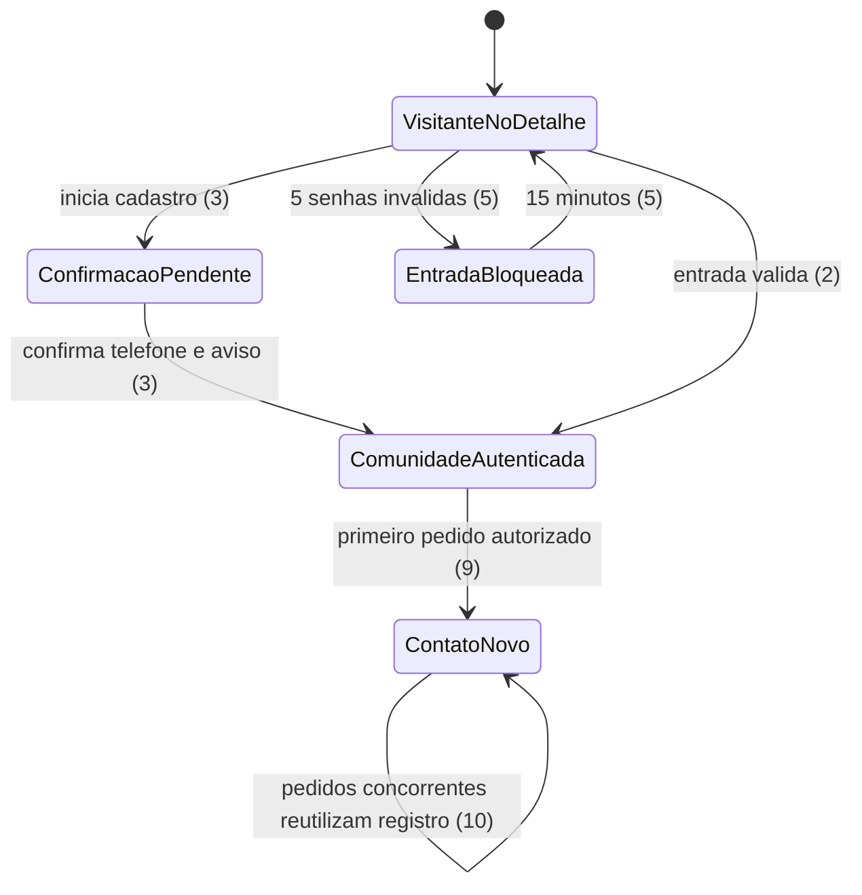
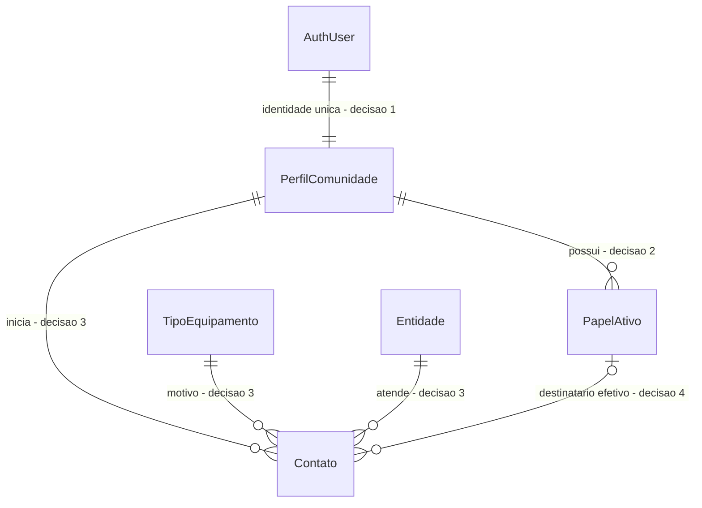

# Entrada da Comunidade e contato pelo WhatsApp

> Construa isto com **tlc-implement**.
> Cada criterio abaixo vira uma verificacao com prova, referenciada pelo numero. Nada em
> `Unresolved` deve ser decidido durante a construcao.

## Intent

Hoje, qualquer visitante pode consultar o detalhe publico de um equipamento, mas a acao de conversa aponta para `/entrar`, rota que ainda nao existe. Tambem nao ha perfis, papeis da Comunidade, contatos ou destinatarios de WhatsApp implementados; por isso, a pessoa interessada nao consegue falar com o banco a partir do equipamento. As fontes nao quantificam o volume de pessoas afetadas.

Este recorte permite que a pessoa entre ou crie cadastro por CPF, volte ao mesmo detalhe e, se tiver o papel Comunidade, inicie um contato pelo WhatsApp mesmo quando a disponibilidade e zero. O link leva a mensagem aprovada, com codigo do contato revisavel antes do envio. Inclui a criacao/reutilizacao minima do contato (FR-014) necessaria para produzir esse codigo e a escolha do destinatario efetivo (FR-016).

15 criterios em 2 fatias · 5 portas unidirecionais · 5 pendencias que bloqueiam go-live · 1 aberta · 0 bloqueios de implementacao.

A segunda fatia depende da sessao e do papel estabelecidos pela primeira. A ordem de revisao natural e entrada/perfil/RLS, depois contato/link; sao costuras possiveis para PRs, mas nao tarefas separadas, pois publicar apenas a entrada faria a pessoa voltar a um detalhe que ainda nao conversa. `AGENTS.md` pede tarefas e checklists leves; nao ha regra de tamanho, modelo de PR ou issue tracker no repositorio.

## Criteria

### Entrar ou criar cadastro e voltar ao equipamento

1. Dado um visitante sem sessao no detalhe de um equipamento, quando um cartao tem disponibilidade zero ou positiva, entao o cartao mostra `Entrar para conversar` com `href="/entrar"`; o cartao e a resposta publica nao incluem telefone, destinatario ou link `wa.me`.
2. Dada uma conta existente com telefone confirmado e papel Comunidade ativo, `/entrar` pergunta se a pessoa ja tem cadastro e, para entrada, pede CPF e depois senha em passos simples. Quando a pessoa envia CPF valido com ou sem pontuacao e a senha correta, o servidor valida o digito verificador, normaliza o CPF para 11 digitos, localiza o telefone confirmado associado e autentica com `phone/password` do Supabase Auth. A pessoa nao escolhe o papel na tela.
3. Dada uma pessoa sem cadastro, quando envia nome, CPF valido, telefone e senha de pelo menos 8 caracteres sem combinacoes artificiais obrigatorias, confirma o telefone por codigo e aceita o aviso de privacidade vigente, entao o perfil fica associado a `auth.users.id`, guarda o CPF normalizado com unicidade e recebe o papel Comunidade pelo servidor. O fluxo permite mostrar/ocultar a senha e nao pede endereco residencial; a versao e a data do aviso aceito ficam registradas.
4. Quando o CPF falha na validacao, o servidor rejeita a tentativa antes da consulta de identidade. Para CPF valido nao cadastrado e senha incorreta, a resposta visivel e a mesma mensagem generica e nao revela se a conta existe nem inclui os dados enviados.
5. Apos 5 senhas invalidas consecutivas, o servidor bloqueia novas tentativas daquela origem por 15 minutos. A duracao e o controle sao aplicados no servidor, nao por estado enviado pelo navegador.
6. Depois de entrada ou cadastro concluido a partir de `/equipamentos/[code]`, incluindo a confirmacao do telefone, a pessoa volta ao mesmo detalhe. As URLs da aplicacao nao incluem CPF, telefone ou nome; o redirecionamento aceita somente destinos internos de detalhe. Sem origem valida, o destino provisoriamente e `/` (ver `Unresolved 6`).
7. Enquanto entrada, cadastro ou confirmacao do telefone aguarda o Supabase Auth, `/entrar` mostra carregamento perceptivel e impede envio duplicado. Se codigo, rede, Auth ou provedor falhar, mostra erro compreensivel e acao para tentar novamente; conta e sessao so sao ativadas depois da confirmacao exigida.

### Iniciar o contato autorizado

8. Dada uma pessoa com sessao e papel Comunidade ativo, com destino WhatsApp autorizado configurado, o detalhe mostra `Conversar no WhatsApp` com disponibilidade zero ou positiva. Pessoa sem esse papel nao recebe telefone nem link direto de WhatsApp; o CTA de visitante continua sendo o da linha 1. Sem destino WhatsApp, aplica-se a alternativa da linha 12.
9. Quando a pessoa autorizada inicia a conversa, o sistema cria um contato em situacao `novo` ou reutiliza o contato da mesma pessoa, banco e tipo de equipamento iniciado nos 30 minutos anteriores, mantendo o mesmo codigo. O destinatario efetivo e o responsavel ativo ou, com modo substituto ligado, o substituto; papel, banco e destinatario sao derivados de dados confiaveis, nao escolhidos pelo navegador.
10. Duas requisicoes concorrentes da mesma pessoa para o mesmo banco e tipo dentro da janela de 30 minutos deixam exatamente um contato e devolvem o mesmo codigo.
11. O link oficial `wa.me` abre exatamente `Ola. Quero conversar sobre um emprestimo de equipamento. Codigo do contato: {codigo}.`, substituindo somente `{codigo}` pelo codigo do contato. A pessoa pode revisar e editar o texto antes de enviar; o sistema nao envia a mensagem. O texto nao contem CPF, telefone, nome do paciente, endereco ou dados de saude; o telefone do destinatario aparece apenas no URL externo autorizado de WhatsApp, conforme a excecao aprovada nesta sessao.
12. Se nao houver destino de WhatsApp configurado para o responsavel efetivo, mas houver telefone de ligacao autorizado, a alternativa exibida e `Ligar` por link externo `tel:`. Se tambem nao houver telefone autorizado, nenhum numero/link e apresentado e a tela explica que o contato nao esta disponivel. A aplicacao nao tenta detectar se o WhatsApp esta instalado; `wa.me` pode abrir o WhatsApp Web.
13. Enquanto cria/reutiliza contato ou obtem o destinatario, a acao mostra carregamento e impede clique duplicado. Se a operacao falhar, a tela mostra estado de erro recuperavel com acao para tentar novamente e nao entrega link/telefone a pessoa sem permissao. A tentativa posterior reutiliza o contato dentro da janela definida na linha 9; CPF, telefone, nome e objetos de erro brutos do Auth nao aparecem em logs ou mensagens de erro.
14. Chamadas diretas ao banco/API como `anon` ou como Companheiro sem papel Comunidade nao leem CPF, telefone, destinatarios ou contatos nem iniciam contatos. A pessoa Comunidade inicia contato apenas com seu proprio `auth.uid()` e nao le registros de outras pessoas; a resolucao de destinatario fica limitada ao banco/tipo solicitados e a papeis ativos. Papel e entidade enviados pelo navegador nao concedem acesso, e as politicas mantem o isolamento entre entidades. O contrato anonimo existente de disponibilidade continua retornando somente nome publico do banco e quantidade.
15. Em `/entrar` e no detalhe, a verificacao visual manual a 360 px nao encontra rolagem horizontal; botoes principais tem pelo menos 56 px e texto em negrito de pelo menos 20 px; texto corrido tem pelo menos 18 px, titulos pelo menos 26 px e contraste de texto pelo menos 4.5:1; foco e informacao nao dependem apenas de cor/icone; CPF, telefone e codigo usam teclado numerico; voltar fica em local previsivel e ha uma acao principal por tela. Usar Azul Real `#17458F`, Dourado `#F7A81B`, Cinza Carvao `#54565A`, Verde `#1E7B3C` e Vermelho `#B3261E`.

## States

## Out of scope

- Recuperacao de senha (FR-011), troca de telefone (FR-012) e cadastro assistido (FR-041); sao fluxos separados.
- Tela/lista administrativa de contatos e mudanca para `atendido`, `sem_retorno` ou `virou_emprestimo` (FR-017/AC-007); este recorte apenas cria ou reutiliza o registro e entrega seu codigo no WhatsApp.
- Tela administrativa para editar responsaveis, substitutos e telefones (FR-039); este recorte precisa consumir a configuracao autorizada para resolver o destinatario, mas nao inclui a tela de manutencao dessa configuracao. Dados reais de destinatarios devem ser carregados fora do Git.
- Envio automatico de WhatsApp, leitura de conversas ou integracao com WhatsApp Business.
- Mudanca no catalogo publico, disponibilidade ou no contrato anonimo `equipment_availability`.
- Troca da pagina publica `/` por uma pagina inicial institucional, FAQ ou pagina publica de privacidade (FR-045).
- Dados pessoais, contas, telefones, destinatarios ou acervo reais em migrations, seeds, fixtures, logs ou evidencias. Todos os dados de prova sao sinteticos.

## Observable

| Surface | Decision | Landing |
| --- | --- | --- |
| detalhe `/equipamentos/[code]` para visitante | CTA `Entrar para conversar` em disponibilidade zero ou positiva, sem destino direto | 1 |
| detalhe `/equipamentos/[code]` para Comunidade | CTA `Conversar no WhatsApp`, inclusive com disponibilidade zero quando ha destino autorizado | 8 |
| detalhe para sessao sem papel Comunidade | sem telefone ou link direto | 8, 14 |
| tela `/entrar` | entrada por CPF e senha, sem escolha de papel | 2, 4, 5 |
| tela `/entrar` | cadastro, confirmacao de telefone, aviso/aceite e ausencia de endereco | 3 |
| tela `/entrar` | carregamento, falha recuperavel, tentativa duplicada e bloqueio temporario | 5, 7 |
| tela `/entrar` | estado vazio | n/a - a tela apresenta formularios, nao uma colecao remota que possa estar vazia |
| redirecionamento de `/entrar` | retorno ao detalhe original; destino interno sem PII; padrao `/` sem origem valida | 6, Unresolved 6 |
| operacao interna de autenticacao | mapeamento CPF para telefone confirmado; erro generico e limite de tentativas | 2, 4, 5, 7 |
| operacao interna de contato | autorizacao, criacao/reuso, destinatario efetivo e falha recuperavel | 9, 10, 13, 14 |
| URL externo `https://wa.me/{telefone}?text={mensagem}` | telefone de destino autorizado e texto editavel com o codigo do contato | 9, 11 |
| URL externo `tel:{telefone}` | alternativa somente quando nao ha destino WhatsApp e ha telefone autorizado | 12 |
| Supabase Data API anonima de disponibilidade | permanece no contrato existente de nome publico e quantidade, sem contato ou dados pessoais | existing - migration `20261013000000_disponibilidade_publica.sql` e teste SQL correspondente |
| API HTTP publica da aplicacao | formato, codigos e versionamento | n/a - nao e decidido nem publicado um novo endpoint HTTP; chamadas internas permanecem escolha da implementacao |
| comando ou tarefa agendada | saida, opcoes e falha parcial | n/a - nenhum comando ou job e criado neste recorte |
| acao destrutiva | confirmacao previa | n/a - nao ha acao destrutiva neste recorte |
| colecao de contatos | agrupamento, codigo e duplicidade | 9, 10 |
| texto lido no WhatsApp | copia aprovada, campo dinamico e proximo passo de revisao/envio | 11 |

## Swept

- validation: 2, 3, 4, 9 - CPF validado/normalizado no servidor, telefone confirmado e contato ligado ao tipo/banco solicitado.
- failure modes: 4, 5, 7, 13 - erros de entrada, confirmacao e contato sao recuperaveis e nao revelam identidade.
- idempotency and retry: 9, 10, 13 - janela de 30 minutos, concorrencia e nova tentativa reutilizam o contato.
- authorization: 8, 14 - papel ativo verificado fora do navegador e RLS testada por chamada direta.
- concurrency and ordering: concorrencia 10; ordenacao n/a - nao ha fila nem processamento ordenado de mensagens.
- data lifecycle: Unresolved 4 - retencao de contatos sem emprestimo tem proposta de 12 meses, ainda sem aprovacao juridica.
- external-dependency failure: 7, 12, 13 - Supabase Auth/SMS falho fica recuperavel; WhatsApp e link externo, e o fallback e condicionado a configuracao autorizada.
- state transitions: 3, 5, 9, 10 - telefone pendente/confirmado, bloqueio temporario e contato `novo` criado/reutilizado.
- observability: 4, 11, 13, 14 - CPF/telefone/nome e erros brutos de Auth nao sao registrados nem devolvidos; telefone de destino so aparece nos links externos autorizados.

## Impact

| Front | What changes |
|---|---|
| domain | new term: `Perfil da Comunidade` - identidade de negocio ligada a uma identidade Supabase Auth, sem credenciais proprias; vive em dados privados do Supabase |
| domain | new term: `Contato` - pedido de conversa associado a pessoa, tipo, banco, codigo e destinatario efetivo; pode ser reutilizado dentro da janela de 30 minutos |
| domain | existing term: disponibilidade publica continua sendo somente contagem agregada; nenhum consumidor atual passa a receber telefone ou contato |
| application | o cartao atual em `src/app/_components/public-equipment.tsx` deixa de usar sempre o CTA de visitante; surge a tela `/entrar` e uma acao autenticada no detalhe existente |
| authentication | `@supabase/ssr` e `@supabase/supabase-js` ja estao instalados, mas ainda nao ha cliente de sessao, entrada, cadastro ou papel na aplicacao |
| Supabase Data API | `public.equipment_availability` continua anonima e limitada ao agregado; CPF, perfis, destinatarios e contatos nao sao adicionados a esse contrato |
| stored data | as migrations atuais nao criam perfis, papeis, contatos ou destinatarios; a mudanca e aditiva, sem backfill de pessoas reais, e usa somente fixtures sinteticas |
| Supabase Auth local | Auth esta habilitado, mas `auth.minimum_password_length=6`, `auth.sms.enable_signup=false` e `auth.sms.enable_confirmations=false`; nao ha provedor SMS configurado em `supabase/config.toml` |
| tests | existem testes SQL de RLS para o catalogo/disponibilidade; nao ha verificacoes de Auth ou contato; a estrategia atual limita automacao a `npm run build` e `supabase test db`, com verificacao visual manual |

## Decided

| Decision | Shape | Alternative rejected |
|---|---|---|
| O CPF identifica o perfil de negocio; o Supabase Auth continua dono das credenciais. | O servidor valida e normaliza CPF, resolve o telefone confirmado associado e autentica por `phone/password` do Supabase Auth. O perfil liga-se por `auth.users.id`, guarda CPF normalizado com unicidade e nunca guarda senha/hash. | CPF como senha ou como email inventado sem estrategia; ambos contrariariam a separacao de credenciais e nao sao a opcao escolhida pelo usuario. |
| Papeis nao sao escolhidos nem confiados ao navegador. | Cadastro proprio concede `comunidade` no servidor; o acesso depende de papel ativo verificado pelo servidor/banco e de RLS. Um perfil pode acumular papeis, mas Companheiro sem Comunidade nao recebe contato direto. | Aceitar `role` ou `entity_id` enviado pelo cliente permitiria elevar acesso. |
| `{codigo}` e o codigo publico do contato, nao o codigo do equipamento. | O contato guarda pessoa iniciadora, tipo, banco, destinatario efetivo e situacao `novo`; um toque da mesma pessoa para o mesmo tipo/banco dentro de 30 minutos reutiliza o contato e seu codigo. | Criar um contato por toque ou usar o codigo do equipamento nao corresponde ao texto aprovado nem a FR-014. |
| O destinatario e resolvido pela configuracao autorizada. | Usar o responsavel ativo, ou o substituto quando o modo substituto estiver ligado; a pessoa nao informa nem escolhe o numero. | Destinatario enviado pelo navegador ou telefone publico ampliaria o limite de confianca. |
| O contato externo e um link revisavel, nunca um envio automatico. | Usar o texto aprovado de `mensagens-padrao.md` com somente `{codigo}` dinamico. O telefone operacional autorizado pode aparecer somente no URL externo `wa.me` ou, no fallback definido, `tel:`; nunca em URL interna, log, erro ou mensagem pre-preenchida. | Envio automatico, numero no payload anonimo ou numero visivel antes da autorizacao violariam FR-013/015 e a minimizacao de dados. |

## Relations

## Surface

| Route | In | Out | Status | Criteria |
|---|---|---|---|---|
| `/equipamentos/[code]` | codigo publico do equipamento e sessao/papel verificados no servidor | CTA de visitante, acao de Comunidade ou nenhuma acao direta para papel sem permissao | tela publica existente com acao condicionada a sessao | 1, 8, 14 |
| `/entrar` | CPF/senha para entrada; nome, CPF, telefone/codigo e senha para cadastro | sessao ou erro recuperavel; retorno a detalhe interno | tela nova; nenhum CPF no URL | 2, 3, 4, 5, 6, 7 |
| `https://wa.me/{telefone}?text={mensagem}` | telefone efetivo autorizado e mensagem com codigo de contato | WhatsApp/WhatsApp Web com texto revisavel | link externo; a pessoa decide se envia | 9, 11 |
| `tel:{telefone}` | telefone autorizado quando falta destino WhatsApp | discador do dispositivo | link externo condicionado a autorizacao | 12 |

## Sources

- [AGENTS.md](../AGENTS.md) - paleta, linguagem, limites de privacidade/RLS e estrategia Lean MVP.
- [Requisitos do Produto](../docs/produto/requisitos.md) - FR-005 a FR-010, FR-013 a FR-016 e NFR-003 a NFR-007.
- [Regras de Negocio](../docs/produto/regras-de-negocio.md) - secao 6: acao com estoque zero, destinatario, codigo de contato, deduplicacao de 30 minutos e situacoes de contato.
- [Criterios de Aceite](../docs/produto/criterios-de-aceite.md) - AC-001, AC-003/004, AC-007/008, AC-021, AC-025, AC-027, AC-035 e AC-036.
- [Acessibilidade e Fluxos](../docs/ux/acessibilidade-e-fluxos.md) - **fonte vinculante para a interface**: secoes 3.5-3.9, 4 e 7 (entrada, cadastro, retorno, fallback e estados).
- [Autenticacao e Autorizacao](../docs/arquitetura/autenticacao-e-autorizacao.md) - papeis, Supabase Auth, RLS e estrategia CPF originalmente pendente; esta tarefa registra a resolucao confirmada nesta sessao.
- [Modelo Conceitual](../docs/arquitetura/modelo-conceitual.md) e [Visao Geral da Arquitetura](../docs/arquitetura/visao-geral.md) - perfil ligado a `auth.users.id`, papeis, contato e limites de confianca.
- [Requisitos de Dados e Privacidade](../docs/privacidade/requisitos-de-dados.md) - minimizacao, aviso/aceite, logs, retencao e aprovacao juridica.
- [Mensagens Padrao](../docs/produto/mensagens-padrao.md) - texto inicial aprovado e unico campo `{codigo}`.
- Decisoes confirmadas pelo usuario nesta sessao: CPF normalizado resolve no servidor para telefone confirmado e Supabase Auth `phone/password`; `{codigo}` e codigo do contato e inclui FR-014 minimo; telefone de destino e permitido somente em link externo autorizado; bloqueio da FR-010 apos cinco erros por 15 minutos com limitacao por origem; fallback `Ligar` apenas sem destino WhatsApp configurado e com telefone autorizado.
- [`src/app/_components/public-equipment.tsx`](../src/app/_components/public-equipment.tsx), [`src/app/equipamentos/[code]/page.tsx`](../src/app/equipamentos/%5Bcode%5D/page.tsx), [`src/lib/public-supabase.ts`](../src/lib/public-supabase.ts) e [`src/lib/availability.ts`](../src/lib/availability.ts) - CTA atual, detalhe, leitura anonima e disponibilidade.
- [`supabase/migrations/20261009000000_catalogo_publico_tipos.sql`](../supabase/migrations/20261009000000_catalogo_publico_tipos.sql), [`supabase/migrations/20261013000000_disponibilidade_publica.sql`](../supabase/migrations/20261013000000_disponibilidade_publica.sql), [`supabase/tests/disponibilidade-publica.test.sql`](../supabase/tests/disponibilidade-publica.test.sql), [`supabase/seed.sql`](../supabase/seed.sql) e [`supabase/config.toml`](../supabase/config.toml) - schema/RLS atual, fixtures sintéticas e Auth local sem SMS habilitado.
- [`package.json`](../package.json), `node_modules/@supabase/auth-js/src/lib/types.ts` e `node_modules/@supabase/auth-js/src/GoTrueClient.ts` - dependencias instaladas e API local de senha por telefone no `signUp`/`signInWithPassword`.
- [README da documentacao](../docs/README.md) - documentos aprovados como fonte de produto e dados sinteticos no repositorio.

Esta tarefa e o registro da decisao. Se uma fonte vinculante divergir, perguntar antes de construir.

## Unresolved

| # | Kind | Question | Until answered |
|---|---|---|---|
| 1 | blocks go-live | Qual provedor SMS, credenciais de producao e limites finais de envio/validade do codigo serao usados? | A confirmacao pode ser provada localmente com OTP sintetico, mas cadastro real por telefone nao pode ser habilitado sem provedor e limites configurados. |
| 2 | blocks go-live | Quais responsaveis ativos/substitutos e telefones autorizados de WhatsApp/ligacao serao configurados para cada banco? | Testes usam destinos sinteticos; nenhum numero real deve entrar em migration, seed ou Git. Sem configuracao autorizada, nao ha destino de producao. |
| 3 | blocks go-live | Qual texto/versionamento do aviso de privacidade e aceite deve ser aprovado juridicamente para o cadastro? | O fluxo e o registro de versao/data podem ser provados com aviso sintetico; cadastro real fica desabilitado ate haver texto aprovado. |
| 4 | blocks go-live | Qual prazo de retencao aprovado se aplica a contatos que nao viram emprestimo? | A proposta de 12 meses ainda depende de aprovacao juridica; nao carregar contatos reais nem declarar o ciclo de dados pronto enquanto a regra nao estiver aprovada. |
| 5 | blocks go-live | Qual tarefa entrega a consulta administrativa do codigo e as mudancas de situacao previstas em FR-017/AC-007? | Este recorte persiste/reutiliza o contato e envia seu codigo, mas nao permite a administradores localizar ou acompanhar contatos dentro do sistema. |
| 6 | open | Para `/entrar` sem origem valida, o retorno padrao deve ser outro destino alem de `/`? | Enquanto nao houver decisao, usar `/` e aceitar como retorno somente uma rota interna de detalhe; nenhum destino externo e permitido. |
