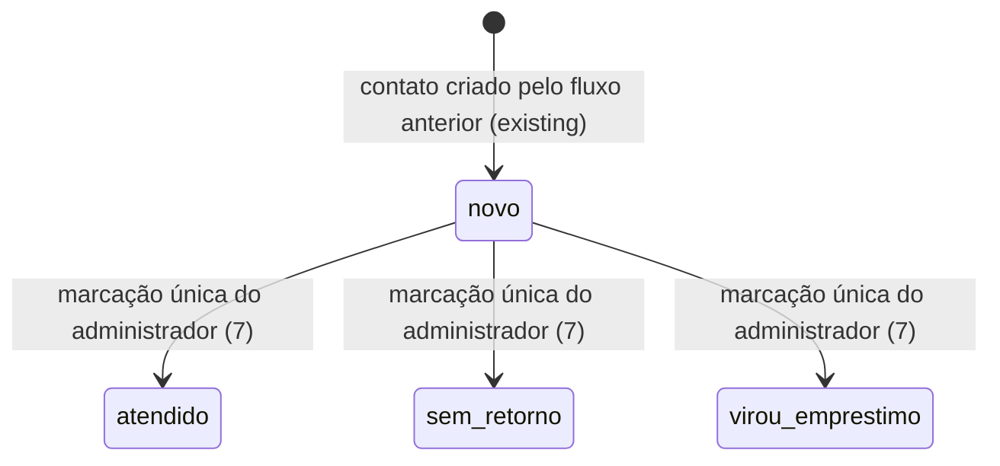
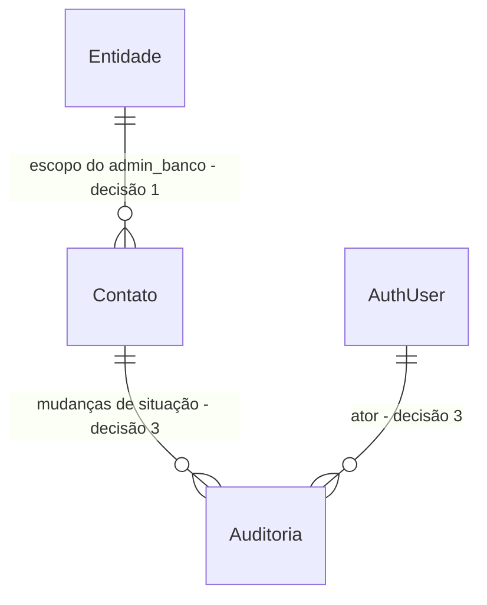

# Gestão administrativa de contatos da Comunidade — FR-017 / AC-007

> Construa isto com **tlc-implement** (`.opencode/skills/tlc-implement/SKILL.md`).
> Cada critério abaixo vira uma verificação com prova, referenciada pelo número. Nada em
> `Unresolved` deve ser decidido durante a construção.

## Intent

Os contatos iniciados pela Comunidade já são persistidos em `catalog.community_contacts` e recebem um código no texto revisável do WhatsApp. Hoje, a aplicação não oferece ao administrador um caminho para localizar esse código nem para registrar o atendimento; a situação permanece `novo`. As fontes não informam o volume de contatos afetados.

Quando este recorte estiver disponível, o administrador do banco correto poderá localizar o contato pelo código da mensagem, acompanhar sua situação, identificar contatos sem ação por 48 horas e registrar um único desfecho previsto em FR-017. A entrada e o provisionamento administrativos são uma dependência separada: este recorte parte de uma sessão autenticada com papel `admin_banco` ativo e vínculo de entidade verificado. A interface usa os nomes e as situações padronizados pelo banco; a disponibilidade pública não muda.

O corte é uma tarefa vertical para localizar, acompanhar e marcar contatos, em duas fatias; a única dependência de ordem é o acesso administrativo, entregue pela tarefa separada e com sessão local confirmada. Para tamanho, o repositório só declara que tarefas e checklists devem ser leves (`AGENTS.md`); a tarefa anterior registra ausência de regra de tamanho/PR ou issue tracker disponível.

16 critérios em 2 fatias · 4 portas unidirecionais · 5 pendências: 1 bloqueia go-live e 4 abertas. A dependência de sessão local e o rótulo da navegação foram resolvidos pelo usuário nesta sessão.

## Criteria

### Localizar e acompanhar contatos do banco correto

1. Dada uma sessão administrativa válida, quando a pessoa abre a navegação principal de administração, então encontra a tarefa de contatos recebidos entre as tarefas prioritárias, sem depender de menu escondido, conforme o fluxo administrativo de UX. O caminho pressupõe a sessão fornecida pela tarefa prévia; esta tarefa não cria entrada nem cadastro administrativo.
2. Dado um `admin_banco` ativo vinculado à entidade E, quando a coleção de contatos de E é carregada, então cada contato de E aparece uma vez com o mesmo `codigo` gravado e sua `situacao` atual. O nome do banco vem do nome público canônico da entidade; as situações usam os valores de `catalog.contact_situation`, apresentados como `Novo`, `Atendido`, `Virou empréstimo` e `Sem retorno`, sem novos estados ou sinônimos.
3. Dado um contato de E cujo código aparece na mensagem do WhatsApp, quando o administrador de E pesquisa esse código, então encontra exatamente esse contato com o mesmo código e a situação atual. O código persistido não é substituído por código de equipamento ou por outro identificador.
4. Enquanto um contato permanece com `situacao = 'novo'` por 48 horas ou mais desde `created_at`, a coleção o destaca com texto ou rótulo perceptível, não somente por cor ou ícone. O destaque não altera automaticamente a situação.
5. Quando o código informado não é um código completo no formato persistido `^[A-F0-9]{12}$`, a pesquisa exata não retorna contato. Um código válido sem correspondência também não retorna contato nem dados de outra entidade.
6. Sempre, o servidor e o banco derivam a pessoa autenticada, o papel ativo `admin_banco` e a entidade autorizada da sessão e de relações confiáveis; valores de papel ou entidade enviados pelo navegador não concedem acesso. Uma pessoa só lê e altera contatos das entidades para as quais possui vínculo `admin_banco` ativo. `anon` e qualquer pessoa sem vínculo `admin_banco` ativo a E — inclusive quem tenha apenas papel Comunidade ou Companheiro — não obtêm dados nem alteram contatos de E; os testes usam entidades sintéticas para as quatro entidades do MVP e tentam também acesso direto. `catalog` continua fora dos schemas expostos pela Data API.

### Registrar uma única mudança de situação

7. Dado um contato em `novo` e um `admin_banco` autorizado para a entidade do contato, quando o administrador o marca como `atendido`, `sem_retorno` ou `virou_emprestimo`, então a mesma linha passa ao valor escolhido de `catalog.contact_situation` e a tela apresenta o rótulo correspondente. Somente `situacao` muda: `codigo`, `user_id`, `entity_id`, tipo, destinatário efetivo, origem e `created_at` permanecem iguais.
8. Para cada mudança confirmada da situação, o sistema grava um registro de auditoria com ator, ação, entidade, contato identificado internamente, situação anterior, situação nova e data/hora. O registro e os logs não incluem CPF, telefone, nome de pessoa atendida nem erro bruto do servidor.
9. Se a mesma mudança for reenviada após ter sido confirmada — por clique repetido ou nova tentativa —, o contato continua com a situação já gravada e há somente um registro de auditoria para essa transição; não é criado outro contato nem alterado seu código.
10. Se dois pedidos simultâneos tentarem mudar o mesmo contato ainda `novo` para destinos diferentes, no máximo uma transição é confirmada. A situação final é um dos três valores permitidos e há um único registro de auditoria; o pedido concorrente não sobrescreve a situação já confirmada.
11. Após uma mudança confirmada, a interface mostra uma confirmação clara que identifica a situação resultante e oferece um único próximo passo.
12. Enquanto a coleção ou a pesquisa aguarda dados, e enquanto uma mudança aguarda resposta, a tela mostra indicador e texto de carregamento; durante o envio, impede o acionamento duplicado.
13. Se uma consulta remota resultar em zero contatos, a tela apresenta um estado vazio de sucesso com explicação e exatamente um próximo passo, sem mostrar contatos de outra entidade como resultado.
14. Se a leitura ou gravação falhar, inclusive por interrupção de rede, a tela mostra uma mensagem compreensível e uma ação recuperável para tentar novamente; não apresenta erro bruto do banco, CPF, telefone ou nome. Uma nova tentativa continua sujeita aos critérios 9 e 10.
15. Se a sessão não tiver permissão para a entidade solicitada, a tela informa a falta de permissão sem revelar se o código ou o contato existem naquela entidade.
16. Na verificação visual manual a 360 px, a tela não tem rolagem horizontal; botões principais têm pelo menos 56 px de altura e texto em negrito de pelo menos 20 px; texto corrido tem pelo menos 18 px e títulos pelo menos 26 px; contraste de texto é pelo menos 4,5:1; foco e informação não dependem apenas de cor/ícone; há uma ação principal por tela. A interface usa linguagem cotidiana, “situação” e a paleta oficial (`#17458F`, `#F7A81B`, `#54565A`, `#1E7B3C`, `#B3261E`). Esta verificação é manual; não criar automação de navegador.

## States

Os três destinos não têm novas transições nesta tarefa. O reuso existente dentro da janela de 30 minutos continua preservando o código e não redefine a situação.

## Out of scope

- Entrada, cadastro, provisionamento e atribuição de papéis administrativos — o usuário confirmou que devem vir em uma tarefa prévia; este recorte pressupõe uma sessão administrativa válida e não inventa esse fluxo. A entrada visível para contatos na navegação principal continua neste recorte.
- Acesso de `admin_geral` aos contatos — permanece aberto em `Unresolved`; não ampliar o escopo global por inferência a partir do enum.
- Criar ou alterar empréstimos, documentos ou equipamentos. `virou_emprestimo` é somente a situação do contato neste recorte.
- Alterar a mensagem, o destinatário, o link revisável de WhatsApp ou a deduplicação de 30 minutos já entregues pela tarefa anterior.
- Alterar `equipment_availability`, a disponibilidade do acervo ou o contrato público de nome do banco e quantidade.
- Automatizar exclusão/anonimização de contatos ou auditoria antes da decisão jurídica de retenção. A proposta de 12 meses para contatos e a proposta inicial de dois anos para auditoria continuam sujeitas à aprovação.
- Resolver os outros gates ainda abertos da tarefa anterior: provedor SMS, destinatários reais, chave `SUPABASE_SERVICE_ROLE_KEY`/proxy confiável, texto jurídico do aviso e destino padrão de `/entrar`. Este recorte não os altera.
- Declarar verificados os procedimentos manuais M-C1–M-C13 ou M-C15 da tarefa anterior: o relatório independente registra somente C14 como aprovado e esses procedimentos como pendentes.
- Usar dados reais em migrations, seeds, testes, logs ou evidências; todos os dados de prova são sintéticos.

## Observable

| Surface | Decision | Landing |
| --- | --- | --- |
| tela `/admin/contatos` | entrada visível `Contatos recebidos` na navegação principal | 1 |
| tela administrativa de contatos | coleção agrupada pelo banco autorizado, código e situação canônicos | 2, 6 |
| tela administrativa de contatos | localizar por código da mensagem | 3 |
| tela administrativa de contatos | destaque após 48 horas sem mudança de `novo` | 4 |
| tela administrativa de contatos | pesquisa por código completo, sem correspondência parcial | 5 |
| tela administrativa de contatos | carregamento | 12 |
| tela administrativa de contatos | vazio: coleção sem contatos ou código válido sem correspondência | 13 |
| tela administrativa de contatos | falha de leitura/gravação e tentativa novamente | 14 |
| tela administrativa de contatos | falta de permissão sem revelar existência de dado | 15 |
| tela administrativa de contatos | ordem e densidade da coleção | Unresolved 5 |
| tela administrativa de contatos | filtros além da pesquisa por código | Unresolved 5 |
| tela administrativa de contatos | campos por contato além de código, situação e destaque de 48 horas | Unresolved 6 |
| tela administrativa de contatos | confirmação antes de gravar a mudança | Unresolved 7 |
| tela administrativa de contatos | confirmação depois de gravar a mudança | 11 |
| tela administrativa de contatos | acessibilidade, linguagem e paleta | 16 |
| coleção de contatos | duplicidade por código | existing - `codigo` é único; a deduplicação de criação em 30 minutos permanece a da tarefa anterior |
| operação privada de contato | autorização, escrita da situação e auditoria | 6–10 |
| API HTTP pública ou webhook | formato, códigos de erro e versionamento | n/a - esta tarefa não publica novo endpoint HTTP ou webhook; operações privadas continuam protegidas por servidor/RLS/RPC |
| Data API anônima de disponibilidade | campos públicos | existing - `equipment_availability` continua retornando somente nome do banco e quantidade, conforme migration e teste existentes |
| comando ou tarefa agendada | saída, opções e falha parcial | n/a - nenhuma ferramenta ou rotina agendada é exigida pelas fontes |
| documento independente | estrutura, tom e próximo passo | n/a - não há novo documento lido por usuários; os textos pertencem à tela e seguem os critérios acima |
| link externo `wa.me` | destinatário e mensagem revisável | existing - permanece inalterado pelo recorte administrativo |

## Swept

- validation: 5, 7 — formato do código e destinos limitados ao enum existente.
- failure modes: 13–15 — vazio, falha recuperável e permissão negada sem revelar contato de outra entidade.
- idempotency and retry: 9 — repetição não cria outra transição ou registro de auditoria.
- authorization: 6, 15 — papel ativo e entidade derivados de fonte confiável, com RLS e teste direto entre entidades.
- concurrency and ordering: 10; ordenação visual da coleção permanece `Unresolved 5`.
- data lifecycle: `Unresolved 2` — retenção de contatos sem empréstimo depende de aprovação jurídica; não automatizar exclusão.
- external-dependency failure: n/a — não se adiciona provedor externo; falhas de rede/servidor ficam cobertas por 14.
- state transitions: 7 e `States` — uma única transição de `novo` para um dos três destinos escolhidos.
- observability: 8 — cada transição confirmada deixa auditoria com ator, entidade, contato, antes/depois e data/hora, sem PII em logs.

## Impact

| Front | What changes |
|---|---|
| domain | existing term: `Contato` continua sendo o pedido iniciado pela Comunidade; `situacao` deixa de ser apenas o valor inicial `novo` e passa a admitir uma única marcação administrativa nesta tarefa. O fluxo anterior cria/reutiliza contatos, mas não há consumidor de situação na aplicação. |
| application | nova tela, navegação principal e ação administrativa para contatos em `/admin/contatos`; a entrada `/admin/entrar` e a sessão `admin_banco` foram entregues pela tarefa prévia. A rota de contatos permanece vazia até este recorte. |
| authorization | `catalog.user_role` e `catalog.user_roles` incluem `admin_banco` com `entity_id` e `admin_geral`; a tarefa prévia implementou a sessão e o resolvedor do vínculo ativo. `community_contacts` tem RLS forçada e ainda não oferece leitura/alteração de situação a administradores; as RPCs existentes são do fluxo da Comunidade. |
| stored data | `community_contacts` já guarda código único, entidade, tipo, `situacao` e `created_at`; a tabela não tem histórico de mudanças nem auditoria de situação. Sem backfill: só as transições futuras recebem auditoria, pois não há eventos antigos para reconstruir; os códigos e demais dados existentes não são alterados. |
| data access | `catalog` continua não exposto pela Data API. A leitura/escrita administrativa precisa permanecer privada e isolada por entidade; as políticas atuais não concedem esse acesso. |
| public contract | `equipment_availability` e o fluxo público de disponibilidade continuam limitados ao nome do banco e quantidade. O detalhe público não recebe telefone, destinatário ou contatos. |
| tests | `supabase/tests/contatos-comunidade.test.sql` cobre o fluxo privado da Comunidade, `anon` e Companheiro, mas não o acesso de `admin_banco` nem a mudança de situação. Só dados sintéticos; futuras validações automatizadas seguem `npm run build` e `supabase test db`, com verificação visual manual. |

## Decided

| Decision | Shape | Alternative rejected |
|---|---|---|
| Um `admin_banco` só opera contatos da entidade à qual seu papel ativo está vinculado. | O ator vem da sessão (`auth.uid()`); `admin_banco` ativo e `entity_id` são conferidos no servidor/banco contra a entidade do contato. Nenhum papel ou entidade enviado pelo navegador concede acesso; `catalog` permanece fora dos schemas expostos pela Data API. | Filtrar somente na tela ou confiar em identificador/papel enviado pelo cliente não protege o isolamento exigido por FR-026, AC-017 e `AGENTS.md`. O acesso de `admin_geral` continua aberto. |
| A situação tem uma única marcação administrativa neste recorte. | `novo` → exatamente um entre `atendido`, `sem_retorno` e `virou_emprestimo`; sem retorno para `novo` nem reclassificação posterior nesta tarefa. Decisão confirmada pelo usuário nesta sessão. | Permitir outras transições ou correções sem regra de produto acrescentaria comportamento não definido por FR-017. |
| Mudança de situação é auditável. | Cada mudança confirmada registra ator, ação, entidade, recurso/identificador interno, alteração e data/hora, com contexto técnico minimizado; a mudança registra a situação anterior e a nova. | Sobrescrever apenas `situacao` não permite recuperar quem fez a mudança nem o que mudou, contrariando FR-031 e o modelo conceitual de auditoria. |
| O contrato público de disponibilidade não muda. | `equipment_availability` continua retornando apenas nome público do banco e quantidade disponível; nenhum contato, código administrativo ou dado pessoal é adicionado. | Expandir a resposta pública violaria AC-002 e o contrato existente de disponibilidade. |
| Rótulo da entrada principal de contatos. | Link visível e acessível `Contatos recebidos` para `/admin/contatos`. Definição explícita do usuário em 2026-10-22. | `Acompanhar contatos` e outros rótulos não foram escolhidos pelo usuário. |

## Relations

## Surface

| Route | In | Out | Status | Criteria |
|---|---|---|---|---|
| `/admin/contatos` | sessão administrativa prévia verificada; código do contato, se pesquisado | nome canônico do banco, código, situação canônica e destaque de 48 horas | carregando, vazio, falha recuperável, sem permissão e sucesso | 1–16 |
| API HTTP pública / webhook | n/a | n/a | n/a - nenhum contrato público novo | n/a |
| Data API anônima `equipment_availability(text)` | código do tipo já previsto pelo contrato existente | `bank_name`, `available_quantity` | existing | existing - migration `20261013000000_disponibilidade_publica.sql` e teste correspondente |

## Sources

- [Tarefa anterior](autenticacao-comunidade-whatsapp-fr-013-fr-015.md) — Out of scope, `Unresolved 5` e gates de go-live: esta tarefa cobre a localização administrativa pelo código e as mudanças de situação; deduplicação e link revisável não são reabertos.
- [Checklist anterior](../.checks/autenticacao-comunidade-whatsapp-fr-013-fr-015.md) e [verificação independente](../.checks/autenticacao-comunidade-whatsapp-fr-013-fr-015.verified.md) — C14 passou; M-C1–M-C13 e M-C15 permanecem sem verificação manual, sem alegar conformidade visual.
- [Tarefa de autenticação administrativa](autenticacao-administrativa.md), [checklist](../.checks/autenticacao-administrativa.md) e [verificação independente](../.checks/autenticacao-administrativa.verified.md) — implementação separada; C2/R2 local confirma a sessão e o destino `/admin/contatos`; demais checks e gates de produção permanecem pendentes.
- [Requisitos do Produto](../docs/produto/requisitos.md) — FR-017, FR-026, FR-027, FR-031 e NFR-003/NFR-007.
- [Critérios de Aceite](../docs/produto/criterios-de-aceite.md) — AC-007 exige que o administrador do banco correto veja cada contato com o mesmo código; AC-017, AC-021 e AC-027 cobrem isolamento, privacidade e estados recuperáveis.
- [Regras de Negócio](../docs/produto/regras-de-negocio.md) — seção 6: dados e situações do contato, destaque após 48 horas, deduplicação e retenção pendente.
- [Acessibilidade e Fluxos](../docs/ux/acessibilidade-e-fluxos.md) — **fonte vinculante para a interface**: navegação e prioridades administrativas na seção 6; estados remotos na seção 7; requisitos de interface nas seções 1 e 2.
- [Autenticação e Autorização](../docs/arquitetura/autenticacao-e-autorizacao.md) — escopo do administrador do banco, papel ativo, RLS e negação por entidade.
- [Modelo Conceitual](../docs/arquitetura/modelo-conceitual.md) — relação entre contato e auditoria, minimização do payload e formato conceitual do registro auditável.
- [Requisitos de Dados e Privacidade](../docs/privacidade/requisitos-de-dados.md) — minimização, dados sintéticos e retenção de contatos sem empréstimo ainda sujeita à aprovação jurídica.
- [AGENTS.md](../AGENTS.md) — linguagem cotidiana em português, paleta, medidas mínimas, RLS para as quatro entidades, dados sintéticos e automação limitada a build/testes de banco.
- [Índice do notebook](../.notebook/INDEX.md) e [nota do fluxo](../.notebook/community-auth-contact-flow.md) — identificam o fluxo de autenticação e contato já implementado.
- [`src/lib/contacts/server.ts`](../src/lib/contacts/server.ts) e [`src/app/actions/contact.ts`](../src/app/actions/contact.ts) — código atual só consulta autorização Comunidade e inicia/reutiliza contato.
- [Tarefa de autenticação administrativa](autenticacao-administrativa.md), [checklist](../.checks/autenticacao-administrativa.md) e [verificação independente](../.checks/autenticacao-administrativa.verified.md) — sessão `admin_banco`, vínculo confiável e destino `/admin/contatos`; C2/R2 local foi confirmado, enquanto outros checks e gates continuam pendentes.
- [`src/app/entrar/actions.ts`](../src/app/entrar/actions.ts), [`src/app/admin/entrar/actions.ts`](../src/app/admin/entrar/actions.ts), [`src/lib/auth/admin-bank.ts`](../src/lib/auth/admin-bank.ts), [`src/proxy.ts`](../src/proxy.ts) e a árvore `src/app` — entradas Comunidade e administrativa permanecem separadas; o Proxy atualiza também rotas `/admin/*`, e `/admin/contatos` continua vazia e protegida.
- [`20261014000000_autenticacao_comunidade.sql`](../supabase/migrations/20261014000000_autenticacao_comunidade.sql) — enum e escopo de `admin_banco`/`admin_geral`; o provisionamento de papel implementado é o de Comunidade.
- [`20261014010000_contatos_comunidade.sql`](../supabase/migrations/20261014010000_contatos_comunidade.sql) e [`20261014020000_perfil_privado_e_uid_rls.sql`](../supabase/migrations/20261014020000_perfil_privado_e_uid_rls.sql) — enum/tabela de contatos, RLS, campos e RPCs privadas do fluxo Comunidade; não há escrita administrativa de `situacao`.
- [`contatos-comunidade.test.sql`](../supabase/tests/contatos-comunidade.test.sql) — teste RLS atual com quatro entidades sintéticas; ainda não testa `admin_banco` ou transições administrativas.
- Decisões confirmadas pelo usuário nesta sessão — autenticação/provisionamento administrativo fica em tarefa prévia; cada contato recebe uma única mudança de `novo` para um dos três destinos de FR-017; a tela usa `/admin/contatos` com o rótulo de navegação `Contatos recebidos`.

Esta tarefa registra a decisão do recorte. Se uma fonte vinculante divergir, perguntar antes de construir.

## Unresolved

| # | Kind | Question | Until answered |
|---|---|---|---|
| 1 | resolved 2026-10-22 | Qual tarefa separada entregará e verificará a entrada/provisionamento administrativos e uma sessão com `admin_banco` ativo e `entity_id` confiável? | `.tasks/autenticacao-administrativa.md` foi implementada; R2/C2 local confirmou sessão e destino `/admin/contatos` em `.checks/autenticacao-administrativa.verified.md:11-14,35`. O relatório independente geral permanece FAIL por outros checks pendentes; esses não substituem nem invalidam a prova desta dependência local. |
| 2 | blocks go-live | Qual prazo de retenção aprovado se aplica aos contatos que não viram empréstimo e aos registros de auditoria associados? | A proposta de 12 meses para contatos não está aprovada; a proposta inicial de dois anos para auditoria também depende de validação. Não automatizar exclusão nem declarar os dados reais liberados para go-live até as decisões jurídicas. |
| 3 | open | `admin_geral` também pode ler e alterar contatos de todas as entidades? | Os critérios exigem o `admin_banco` da entidade correta. Não conceder nem declarar acesso global para `admin_geral` por inferência do enum; o restante do recorte fica igual. |
| 4 | resolved 2026-10-22 | Qual é o rótulo literal da entrada de contatos recebidos na navegação administrativa? | O usuário definiu `Contatos recebidos`; decisão registrada em `Decided`. |
| 5 | open | Além da pesquisa por código, quais filtros, ordenação e densidade a coleção deve oferecer? | A coleção inclui todos os contatos autorizados e a pesquisa por código é obrigatória; nenhum outro filtro ou ordem de apresentação é critério decidido. |
| 6 | open | Devem ser exibidos campos por contato além do código, da situação e do destaque de 48 horas? | O nome canônico do banco pode identificar o contexto da tela; não acrescentar nome da pessoa, telefone, destinatário ou outros dados pessoais por contato sem decisão explícita. |
| 7 | open | É necessária uma confirmação antes de gravar a mudança de situação? | A confirmação clara após o sucesso segue o critério 11; nenhum diálogo de confirmação prévia foi decidido ou deve ser presumido. |
