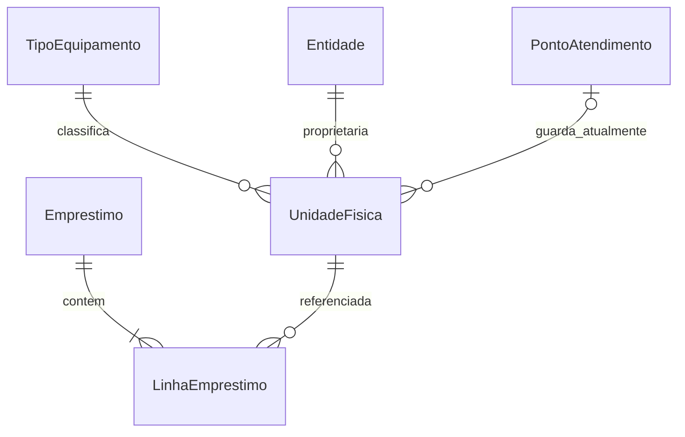

# Disponibilidade publica e cartoes por banco

> Construa isto com **tlc-implement**.
> Cada criterio abaixo vira uma verificacao com evidencia referenciada pelo numero. Nada em
> `Unresolved` deve ser decidido durante a implementacao.

## Intent

Hoje a Data API publica os tipos ativos, mas nao ha consulta publica de disponibilidade por banco nem tela publica de lista e detalhe; `src/app/page.tsx` continua sendo o scaffold do Next.js e o banco ainda nao tem registros de unidades fisicas. A comunidade nao consegue comparar a disponibilidade dos bancos antes de iniciar um contato.

Este recorte e 100% visitante/publico e entrega a parte de disponibilidade do FR-002 e os cartoes por banco do FR-003. A lista e o detalhe mostram quantidades derivadas das unidades cuja coluna tecnica `catalog.equipment_units.situacao` vale `disponivel`; a interface usa o rotulo **Disponível no depósito**. O detalhe preserva o cartao com zero disponibilidade e a acao de conversa, enquanto a API anonima retorna somente nome publico do banco e quantidade.

10 criterios em 1 recorte; 6 portas unidirecionais; 1 pendencia blocks go-live e nenhum criterio bloqueado para implementacao.

## Criteria

### Consulta publica de disponibilidade por tipo

1. Dado um tipo ativo com dados sinteticos, quando a disponibilidade e consultada, entao a quantidade por banco e igual a `COUNT(*)` das unidades daquele tipo cuja `situacao` e `disponivel`; para a Entidade Sintetica A, com 3 unidades `disponivel` e uma em cada situacao `reservado`, `emprestado`, `manutencao`, `doado` e `baixado`, o resultado e 3; para a Entidade Sintetica B, com 2 unidades `disponivel`, o resultado e 2.
2. Dado que uma unidade pertence a uma entidade e esta guardada em um ponto de atendimento compartilhado com outra entidade, quando a disponibilidade e agrupada, entao a quantidade fica com a entidade proprietaria; alterar somente o ponto de guarda nao transfere a quantidade para outra entidade.
3. Quando uma consulta anonima solicita disponibilidade para um tipo, entao cada resultado contem somente o nome publico do banco e a quantidade inteira disponivel; o codigo do tipo vem do contexto da consulta e nenhum identificador de unidade ou outro campo operacional e retornado.
4. Sempre, uma chamada direta sem sessao ou pelo papel Companheiro nao retorna unidades individuais, movimentacoes, emprestimos, linhas de emprestimo, CPF, telefone, endereco residencial ou outros dados pessoais; a leitura publica passa somente pelo recurso agregado autorizado no banco.
5. Dado um banco que possui unidades de um tipo, mas nao possui nenhuma com `situacao = 'disponivel'`, quando a pessoa abre o detalhe, entao o cartao desse banco permanece visivel com quantidade zero e o texto exato `Todos emprestados no momento`.
6. Dado um detalhe com ao menos dois bancos com quantidade positiva e um banco com quantidade zero, quando duas consultas usam permutacoes aleatorias controladas diferentes, entao cada resposta coloca todos os bancos disponiveis primeiro, segue a permutacao daquela consulta dentro desse grupo e coloca os cartoes com quantidade zero depois.
7. Dado um cartao com quantidade zero, quando a pessoa sem sessao o consulta, entao a acao `Entrar para conversar` permanece visivel e aponta para `/entrar`, sem abrir WhatsApp nem revelar telefone ou destino direto.
8. Na lista e no detalhe publicos, em viewport de 360 px nao ha rolagem horizontal; texto corrido tem pelo menos 18 px, botoes principais pelo menos 56 px e texto em negrito de pelo menos 20 px. Usar a paleta Rotary definida em `AGENTS.md`; disponibilidade tambem e comunicada em texto, nao somente por cor ou icone.
9. Enquanto a consulta remota esta pendente, a tela publica mostra indicador e texto de carregamento, conforme a regra existente de acessibilidade.
10. Se a consulta remota falha, a tela publica mostra mensagem compreensivel e uma acao para tentar novamente, conforme AC-027; a falha nao e apresentada como quantidade zero.

## Out of scope

- Alterar o catalogo de tipos, sua ordem aprovada, descricoes ou imagens; esta tarefa consome os tipos ativos do recurso publico existente e cobre a disponibilidade do FR-002.
- Carregar saldos reais da Fase 1, executar a conferencia/etiquetagem da Fase 2 ou reconciliar divergencias entre N informado e quantidade fisica, inclusive itens em emprestimos abertos.
- CRUD administrativo de unidades, movimentacoes, emprestimos, painel do Companheiro ou consulta publica de qualquer linha operacional.
- Criar cadastro/autenticacao por CPF, exibir destino direto de WhatsApp ou abrir link `wa.me`; esses comportamentos ficam para o recorte seguinte, depois da autenticacao por CPF. O CTA publico aponta para `/entrar`, mas a rota nao existe ainda na arvore atual e sua tela permanece fora deste recorte.
- Incluir dados pessoais reais, telefones de producao, destinos reais de WhatsApp ou inventario real em migrations, seeds, fixtures, screenshots ou logs.

## Observable

| Surface | Decision | Landing |
| --- | --- | --- |
| tela publica de lista | carregamento com indicador e texto | 9 |
| tela publica de lista | falha recuperavel e tentativa novamente | 10 |
| tela publica de lista | disponibilidade agregada por tipo | 1, 2, 3 |
| detalhe publico do tipo | cartao com zero disponibilidade | 5 |
| detalhe publico do tipo | ordenacao dos cartoes | 6 |
| detalhe publico do tipo | CTA do visitante sem sessao e destino `/entrar` | 7 |
| tela publica de lista e detalhe | viewport, controles e informacao nao dependente de cor | 8 |
| Supabase Data API, leitura anonima do recurso de disponibilidade por tipo | nome publico do banco e quantidade; nome fisico do recurso e escolhido na implementacao | 3 |
| Supabase Data API | autorizacao, isolamento de linhas e campos privados | 4 |
| Supabase Data API | formato de erro | existing - comportamento nativo da Data API; a tela converte a falha em mensagem e acao conforme 10 |
| Supabase Data API | versionamento e limite de requisicoes | n/a - usa o recurso Data API existente; nao ha requisito de versao ou limite especifico neste recorte |
| comando ou tarefa agendada | output, opcoes e falha parcial | n/a - nenhum comando ou tarefa agendada e criado |
| colecao de cartoes por banco | agrupamento e ordem | 5, 6 |

## Swept

- validation: 1, 2, 3 - compara a quantidade com unidades sinteticas por situacao e entidade proprietaria.
- failure modes: 10 - falha de leitura produz mensagem recuperavel, nao uma quantidade zero.
- idempotency and retry: n/a - as consultas sao somente leitura e a tentativa novamente nao cria dados.
- authorization: 4, 7 - RLS e privilegios no banco limitam a resposta publica; o visitante nunca recebe destino direto de contato.
- concurrency and ordering: concorrencia n/a - a tarefa so consulta; ordenacao 6 - o grupo disponivel e permutado por consulta.
- data lifecycle: synthetic only - testes usam unidades sinteticas; carga real e reconciliacao permanecem fora deste recorte.
- external-dependency failure: 10 - indisponibilidade da consulta tem recuperacao pela interface conforme AC-027.
- state transitions: n/a - a consulta nao altera a situacao das unidades.
- observability: n/a - nao ha requisito de telemetria; evidencias ficam nos testes sem registrar dados pessoais.

## Impact

| Front | What changes |
|---|---|
| domain | disponibilidade publica passa a significar contagem de unidades com `situacao = 'disponivel'`, agrupada por tipo e entidade proprietaria; ponto de guarda nao e chave de agrupamento |
| domain | estado de disponibilidade zero no detalhe mostra `Todos emprestados no momento` e nao remove o cartao |
| stored data | existe apenas `catalog.equipment_types`; nao ha unidades, entidades ou saldo real para migrar. A implementacao precisa consultar unidades individuais; este recorte usa somente dados sinteticos em testes |
| Supabase Data API | ja existe `public.equipment_types`, read-only e protegido por RLS; o recurso agregado nao pode expor linhas de unidades, movimentacoes, emprestimos ou dados pessoais |
| application | `src/app/page.tsx` e scaffold; a lista e o detalhe publicos ainda nao existem |
| authentication | nao ha rota `/entrar` em `src/app` atualmente; este recorte fixa o destino do CTA, mas nao implementa autenticacao. O link `wa.me` permanece para o recorte seguinte, apos autenticacao por CPF |

## Decided

| Decision | Shape | Alternative rejected |
|---|---|---|
| A disponibilidade por banco e derivada das unidades fisicas. | Para um tipo e uma entidade proprietaria, contar somente unidades com `catalog.equipment_units.situacao = 'disponivel'`; nao manter quantidade agregada editavel. O ponto de guarda atual nao define o banco do agregado. | Uma contagem editavel paralela poderia divergir das situacoes das unidades e da propriedade. |
| A leitura publica segue o limite de confianca da Data API e do banco. | Consulta anonima somente de leitura, com autorizacao no PostgreSQL/RLS; o nome fisico do recurso e escolhido durante a implementacao seguindo o padrao `public.equipment_types`. | Filtrar ou remover campos somente na interface nao protege chamadas diretas a API. |
| O contrato sem sessao da disponibilidade e minimo. | Para o tipo selecionado, cada resultado expoe semanticamente somente nome publico do banco e quantidade disponivel; nomes fisicos das chaves nao sao fixados neste plano. | Expor identificadores de unidade, situacoes operacionais, contato ou dados pessoais amplia o contrato publico sem necessidade para a consulta. |
| Banco sem unidades disponiveis continua no detalhe. | Para quantidade zero, manter o cartao e mostrar exatamente `Todos emprestados no momento`; a API continua retornando quantidade zero, e o texto e apresentado pela interface. | Omitir o banco esconde a indisponibilidade e contradiz o texto solicitado para o detalhe. |
| Bancos disponiveis aparecem antes dos indisponiveis. | A cada consulta, permutar a ordem dos bancos com quantidade positiva; colocar depois todos os cartoes com quantidade zero. | Ordem fixa entre bancos disponiveis pode privilegiar um banco de forma sistematica. |
| Acao publica de conversa nao revela contato direto. | Com quantidade zero, visitante sem sessao ve `Entrar para conversar` com destino `/entrar`; nao recebe telefone, destino ou link `wa.me`. A acao direta `Conversar no WhatsApp` fica para o recorte posterior de autenticacao por CPF. | Expor contato direto antes de autenticar ou esconder o CTA por falta de estoque viola os esclarecimentos de produto. |

## Relations

As relacoes abaixo sao conceituais. Na implementacao, o ponto de atendimento e persistido em `catalog.pontos_atendimento`, e a situacao da unidade fica em `catalog.equipment_units.situacao`; os identificadores tecnicos nao sao rotulos de tela.

## Surface

| Route | In | Out | Status | Criteria |
|---|---|---|---|---|
| Supabase Data API: leitura do recurso publico de disponibilidade por tipo; nome fisico escolhido na implementacao | codigo de tipo ativo ja publico; papel `anon` | por banco: nome publico e quantidade disponivel, sem outros campos | resposta nativa da Data API; somente leitura e RLS; erros de tela conforme 11 | 1, 2, 3, 4, 6 |
| Lista publica de equipamentos | tipos ativos e suas consultas de disponibilidade | tipos existentes com disponibilidade agregada em texto; sem identificador de unidade | interface publica | 1, 3, 8, 9, 10 |
| Detalhe publico de um tipo | tipo selecionado e cartoes de disponibilidade | um cartao por banco que possui o tipo; cartao zero conforme 5; ordem conforme 6; CTA visitante conforme 7 | interface publica; `/entrar` permanece scaffold e a acao autenticada fica fora deste recorte | 5, 6, 7, 8 |

## Sources

- [Requisitos do Produto](../docs/produto/requisitos.md) - FR-002, FR-003, FR-013, FR-015, NFR-002, NFR-003 e NFR-004.
- [Regras de Negocio](../docs/produto/regras-de-negocio.md) - unidade fisica, situacoes, disponibilidade, contato por WhatsApp e saldo inicial.
- [Criterios de Aceite](../docs/produto/criterios-de-aceite.md) - AC-001, AC-002, AC-018 e AC-027.
- [Fluxos de interface](../docs/ux/acessibilidade-e-fluxos.md) - **fonte vinculante para o fluxo** da lista/detalhe publico, acao para entrar e estados remotos.
- [Autenticacao e Autorizacao](../docs/arquitetura/autenticacao-e-autorizacao.md) - matriz de papeis, contato autenticado e RLS; estrategia de entrada permanece pendente.
- [Requisitos de Dados e Privacidade](../docs/privacidade/requisitos-de-dados.md) - classificacao publica, minimizacao e isolamento de PII.
- [Modelo Conceitual](../docs/arquitetura/modelo-conceitual.md) - unidade individual, propriedade/ponto de atendimento, disponibilidade derivada e linha de emprestimo.
- [Catalogo publico de tipos ativos](catalogo-publico-tipos-ativos.md) e [checks verificados](../.checks/catalogo-publico-tipos-ativos.verified.md) - recurso existente de tipos ativos e evidencia C1-C4; nao implementa disponibilidade nem interface.
- [`supabase/migrations/20261009000000_catalogo_publico_tipos.sql`](../supabase/migrations/20261009000000_catalogo_publico_tipos.sql), [`supabase/seed.sql`](../supabase/seed.sql) e [`supabase/tests/catalogo-publico.test.sql`](../supabase/tests/catalogo-publico.test.sql) - unica tabela/view atual, 13 tipos ativos sinteticos e padrao de RLS/Data API.
- [`src/app/page.tsx`](../src/app/page.tsx) e [`AGENTS.md`](../AGENTS.md) - scaffold atual e regras vinculantes de acessibilidade, linguagem, RLS e privacidade.
- Esclarecimentos fornecidos nesta sessao, referenciados como secoes 6.1 e 6.2 do PDF - texto do cartao sem disponibilidade, CTA visivel com estoque zero, ordem aleatoria, contrato anonimo minimo e destino `/entrar`; WhatsApp direto fica para depois da autenticacao por CPF.

Esta tarefa e o registro da decisao para implementacao. Se uma fonte vinculante divergir, perguntar antes de construir.

## Unresolved

| # | Kind | Question | Until answered |
|---|---|---|---|
| 1 | blocks go-live | Qual tarefa/processo carregara os saldos reais da Fase 1 como unidades individuais antes da publicacao da disponibilidade? | Os criterios podem ser provados com dados sinteticos, mas a consulta nao representa acervo real ate existirem as N unidades carregadas. A regra para divergencias entre N e a quantidade fisica, inclusive emprestimos abertos, continua em aberto conforme as regras de negocio. |
